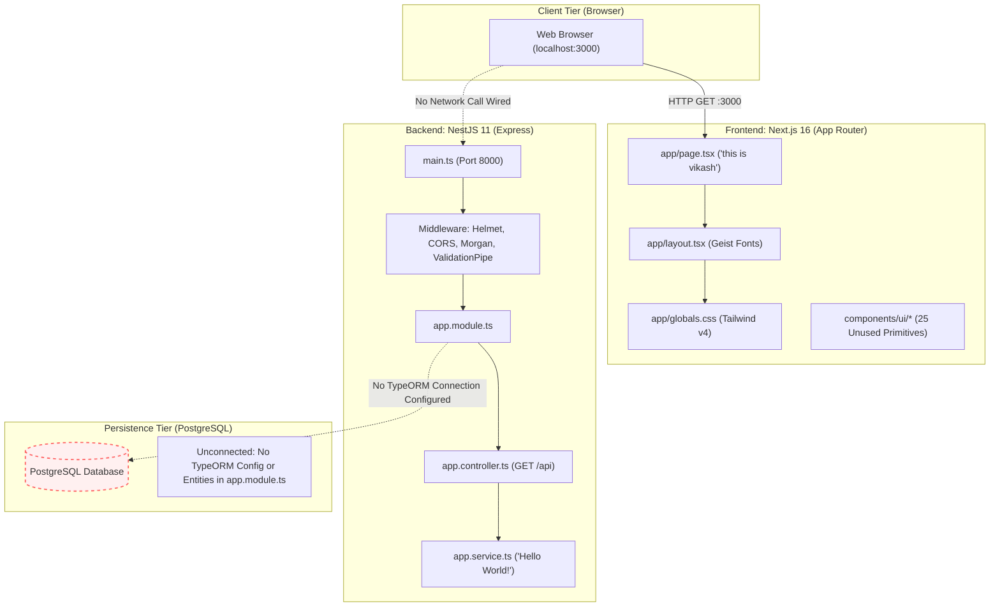

# LMS Platform — Comprehensive Repository Discovery, Product Analysis & Technical Audit Report

> **Investigation Date:** November 17, 2026  
> **Auditor Role:** Principal Software Architect, Senior Full-Stack Engineer & Technical Product Analyst  
> **Repository Path:** `C:\Users\Vikash\lms-platform`  
> **Repository Git Remote:** `https://github.com/Vikash7t/lms-platform.git` (branch `main`)  
> **Scope:** Complete discovery, technical audit, code inspection, and architectural assessment.  
> **Mode:** Read-only static inspection and non-destructive evaluation. (Strictly no modifications, refactoring, migrations, or code changes).

---

## Table of Contents

1. [Executive Summary](#1-executive-summary)
2. [Product Overview](#2-product-overview)
3. [Problem Statement and Target Users](#3-problem-statement-and-target-users)
4. [Product Capabilities and Core Value Proposition](#4-product-capabilities-and-core-value-proposition)
5. [Complete Feature Inventory](#5-complete-feature-inventory)
6. [Learner User Journeys](#6-learner-user-journeys)
7. [Instructor User Journeys](#7-instructor-user-journeys)
8. [Administrator User Journeys](#8-administrator-user-journeys)
9. [Technology Stack](#9-technology-stack)
10. [Repository Structure](#10-repository-structure)
11. [System Architecture](#11-system-architecture)
12. [Frontend Architecture](#12-frontend-architecture)
13. [Backend Architecture](#13-backend-architecture)
14. [Database Documentation](#14-database-documentation)
15. [API Documentation](#15-api-documentation)
16. [Authentication and Authorization](#16-authentication-and-authorization)
17. [Course and Content Management Analysis](#17-course-and-content-management-analysis)
18. [Assessment and Evaluation System](#18-assessment-and-evaluation-system)
19. [Learning Progress and Certification](#19-learning-progress-and-certification)
20. [External Services and Integrations](#20-external-services-and-integrations)
21. [UI/UX Assessment](#21-uiux-assessment)
22. [Code Quality Assessment](#22-code-quality-assessment)
23. [Security Assessment](#23-security-assessment)
24. [Testing and Quality Assurance](#24-testing-and-quality-assurance)
25. [Performance and Scalability](#25-performance-and-scalability)
26. [Development Setup Guide](#26-development-setup-guide)
27. [Deployment Architecture](#27-deployment-architecture)
28. [Completed, Incomplete, and Broken Features](#28-completed-incomplete-and-broken-features)
29. [Technical Risks and Limitations](#29-technical-risks-and-limitations)
30. [Overall Project Maturity Assessment](#30-overall-project-maturity-assessment)
31. [Questions and Unknowns Requiring Verification](#31-questions-and-unknowns-requiring-verification)
32. [ORIGINAL VIDEO REFERENCE VS LOCAL IMPLEMENTATION](#32-original-video-reference-vs-local-implementation)
33. [WHAT WE SHOULD DO NEXT](#33-what-we-should-do-next)

---

## 1. Executive Summary

A comprehensive architectural and engineering audit of the `lms-platform` repository was conducted to establish an objective baseline of its current purpose, technical stack, architecture, implementation status, and software maturity.

### Key Audit Findings

1. **Project Nature & Lifecycle Stage:**  
   Despite the repository name `lms-platform`, the codebase is currently at an **embryonic, pre-functional scaffolding stage** (Day 0–1 project setup). The repository represents a newly initiated project skeleton consisting of an initialized NestJS 11 backend and an uncommitted Next.js 16 frontend.

2. **Backend Status:**  
   The backend was created using the NestJS CLI (`@nestjs/cli 11.0.0`). A developer subsequently installed several foundational npm packages intended for authentication (`passport`, `passport-jwt`, `passport-google-oauth20`, `jsonwebtoken`, `bcryptjs`), database connectivity (`typeorm`, `pg`, `@nestjs/typeorm`), and validation (`class-validator`, `class-transformer`, `joi`, `express-validator`).  
   In `backend/src/main.ts`, basic middleware was wired up (Helmet security headers, Morgan logging, CORS configuration, and a global `ValidationPipe`), and a global route prefix of `api` was defined.  
   **However, no business logic, domain modules, database entities, authentication controllers/guards, course management, or LMS APIs have been authored.** The backend only contains the boilerplate `AppController` and `AppService`, serving a single endpoint: `GET /api` returning `"Hello World!"`.

3. **Frontend Status:**  
   The frontend was bootstrapped using `create-next-app` with Next.js 16.3.0, React 19.2.8, Tailwind CSS v4, and TypeScript. Twenty-five UI primitive components were generated via `shadcn/ui` in `frontend/components/ui/`.  
   **However, zero application pages or LMS interfaces have been built.** The root application page (`frontend/app/page.tsx`) consists of a single 9-line file rendering `<div>this is vikash</div>`. There are no course catalogs, dashboards, authentication forms, student views, or instructor interfaces.

4. **Source Control Discrepancy:**  
   The Git commit history consists of only two commits:
   - `b759593 chore: initialize LMS backend` (Aug 13, 2026)
   - `c3b8e62 the frontend setup` (Aug 14, 2026)  
   In commit `c3b8e62`, only `backend/package.json` and `backend/package-lock.json` were committed. **The entire `frontend/` directory was never added to Git and is currently an untracked directory in the working tree.** Furthermore, `backend/src/main.ts`, `backend/package.json`, and `backend/.env` have uncommitted changes.

5. **LMS Domain Functionality Delivered:**  
   **None (Pre-Functional Scaffolding Stage).** Zero LMS domain features (courses, enrollments, lessons, videos, quizzes, submissions, progress tracking, certificates, or roles) have been implemented in either the frontend or backend.

---

## 2. Product Overview

### 2.1 Intended Product Concept
The intended product is a **Udemy-like online learning marketplace** designed to connect three primary user groups:
1. **Learners:** Individuals who discover educational content, purchase/enroll in courses, consume structured multimedia lessons, complete evaluations, and track their learning history.
2. **Instructors:** Course creators and educators who author curricula, upload media, define assessments, price courses, publish educational materials, and oversee their enrolled students.
3. **Administrators:** Platform operators who manage platform health, moderate courses, manage user roles, and govern system-wide settings.

### 2.2 Core Product Lifecycle and Information Flow
The end-to-end product flow of the intended marketplace operates in seven sequential stages:
1. **Course Authoring & Management:** Instructors draft, organize (categories, sections, lectures), and configure courses (pricing, thumbnails, promotional content) and submit them for publishing.
2. **Platform Governance:** Administrators oversee platform operations, review course submissions, moderate content, and manage user access control.
3. **Course Discovery:** Prospective learners browse the public storefront, search by keywords, filter by category taxonomy, and review course details and curricula previews.
4. **Enrollment & Registration:** Learners create accounts or authenticate (via email/password or Google OAuth) and initiate course enrollment.
5. **Monetization & Checkout:** Where a course is paid, an integrated payment gateway (e.g., Razorpay) processes transactions securely, verifies cryptographic payment signatures, and triggers enrollment provisioning.
6. **Content Delivery & Consumption:** Enrolled learners access the dedicated learning viewer to stream lecture media and read supplementary lesson notes.
7. **Activity Tracking & Records Management:** The platform tracks lesson completions, manages assessment/quiz submissions, and preserves learner activity records.

### 2.3 Actual Delivered Codebase
In contrast to the comprehensive intended marketplace model, the physical repository is a **dual-project multi-directory workspace** (`backend/` and `frontend/`) consisting exclusively of initialized framework starter skeletons and installed dependencies, without any domain-specific data models, business logic services, database tables, or interactive UI views.

### 2.4 Product Evidence
- In `backend/package.json`: Dependencies on `@nestjs/jwt`, `passport-google-oauth20`, `passport-jwt`, `bcryptjs`, `typeorm`, and `pg` confirm an intention to build a database-driven system with credential-based and Google OAuth authentication.
- In `frontend/components/ui/`: UI primitives including `accordion.tsx`, `progress.tsx`, `table.tsx`, `tabs.tsx`, `sidebar.tsx`, `carousel.tsx`, `dialog.tsx`, and `sheet.tsx` confirm preparation for complex dashboard and content-delivery layouts.

---

## 3. Problem Statement and Target Users

### 3.1 Problem Statement
Modern online education requires scalable platforms where educators can structure learning modules and learners can consume media, verify competency through assessments, and track milestone completion. The repository aims to address this need by creating a dedicated full-stack learning platform.

### 3.2 Target Audience (Inferred from Technical Architecture & Dependencies)
Based on the package manifest footprints (`passport-google-oauth20`, `passport-jwt`, `sidebar.tsx`, `table.tsx`, `progress.tsx`), the planned system is aimed at:
1. **Learners / Students:** Individuals seeking to authenticate (via email/password or Google OAuth), browse course catalogs, view lessons, track completion percentages, and complete assessments.
2. **Instructors / Course Creators:** Educators requiring dashboards to build course curricula, upload materials, manage quizzes, and review learner progress.
3. **Platform Administrators:** Managers requiring administrative oversight. In the reference tutorial project, demonstrated administrative capabilities are focused on category management, system-wide course listing oversight, user role allocation, and reviewing instructor onboarding applications. Broader marketplace governance features (such as automated revenue disbursement, multi-tiered institutional compliance, automated copyright detection, or dispute arbitration) represent generalized enterprise assumptions rather than functionality demonstrated in the tutorial or implemented locally.

*Note: There is zero evidence in the codebase for multi-tenant enterprise tenancy, SCORM compliance, or institutional school district SIS integration.*

---

## 4. Product Capabilities and Core Value Proposition

### 4.1 Intended Value Proposition
To provide a modern, responsive web application for online learning, backed by a robust NestJS REST API and PostgreSQL database, featuring secure JWT/OAuth authentication and modular course management.

### 4.2 Current Realized Capabilities
- **Backend:** Capable of starting an HTTP server on port 8000 with Helmet security headers, CORS origin verification (`http://localhost:3000`), Morgan request logging, global payload validation via class-validator, and returning `"Hello World!"` at `GET /api`.
- **Frontend:** Capable of starting a Next.js 16 development server on port 3000, loading Geist fonts, importing Tailwind CSS v4 styling rules, and rendering `"this is vikash"`.
- **LMS Domain Capabilities:** **None.**

---

## 5. Complete Feature Inventory

| Module / Feature | Stated Purpose | Frontend File(s) | Backend File(s) | Database Entity | Implementation Status | Evidence / Notes |
|---|---|---|---|---|---|---|
| **Root Health Check** | Verify server health | None | `backend/src/app.controller.ts` (L8-11) | None | **Implemented & Functional** | Returns `"Hello World!"` with HTTP 200 at `GET /api`. |
| **HTTP Security Headers** | Set security response headers | N/A | `backend/src/main.ts` (L13) | None | **Implemented & Functional** | Uses `helmet()` middleware. |
| **CORS Filtering** | Restrict cross-origin access | N/A | `backend/src/main.ts` (L16-21) | None | **Implemented & Functional** | Configured for `FRONTEND_URL` / `http://localhost:3000`. |
| **Request Logging** | Log incoming HTTP traffic | N/A | `backend/src/main.ts` (L24) | None | **Implemented & Functional** | Configured with `morgan('combined')`. |
| **Global DTO Validation** | Enforce payload whitelisting | N/A | `backend/src/main.ts` (L27-33) | None | **Configured (No DTOs)** | Global `ValidationPipe` active, but no DTOs exist. |
| **User Registration** | Learner/Instructor sign-up | None | None | None | **Planned / Unimplemented** | `bcryptjs` installed; no controller, service, or model. |
| **User Login (Password)** | Credential authentication | None | None | None | **Planned / Unimplemented** | `passport-jwt` installed; no auth module created. |
| **Google OAuth Login** | Social single sign-on | None | None | None | **Planned / Unimplemented** | `passport-google-oauth20` installed; no strategy created. |
| **Role-Based Access Control** | Distinguish roles (Admin/Student) | None | None | None | **Not Implemented** | No role enum, guards, or decorators defined. |
| **Course Catalog** | Display available courses | None | None | None | **Not Implemented** | No course routes, components, or entities. |
| **Course Creation** | Instructor course builder | None | None | None | **Not Implemented** | No course management code exists. |
| **Curriculum / Lessons** | Module & lesson organization | None | None | None | **Not Implemented** | No curriculum entities or APIs. |
| **Video / Content Player** | Display lesson media | None | None | None | **Not Implemented** | No media players or streaming endpoints. |
| **Enrollment System** | Register student for course | None | None | None | **Not Implemented** | No enrollment logic or schema. |
| **Progress Tracking** | Monitor lesson/course completion | None (`progress.tsx` exists as unused UI) | None | None | **Not Implemented** | UI component uninstantiated; no backend logic. |
| **Assessments / Quizzes** | Test learner knowledge | None | None | None | **Not Implemented** | No quiz/exam models or submission pipelines. |
| **Grading & Results** | Score submissions | None | None | None | **Not Implemented** | No grading logic exists. |
| **Certificates** | Issue completion credentials | None | None | None | **Not Implemented** | No PDF generator or certificate records. |
| **Admin User Management** | Manage system accounts | None (`table.tsx` exists as unused UI) | None | None | **Not Implemented** | No user management controllers or pages. |
| **File Storage / Uploads** | Store course assets/media | None | None | None | **Not Implemented** | No Multer, S3, or upload endpoints configured. |

---

## 6. Learner User Journeys

### 6.1 Reconstructed Workflow Reality
In an operational LMS, the learner journey encompasses catalog discovery, course enrollment, lecture streaming, exercise completion, progress tracking, and certificate receipt.

### 6.2 Existing Codebase Inspection
- **Step 1: Visitor visits application root (`/`):**  
  The browser requests `http://localhost:3000`. Next.js executes `frontend/app/page.tsx`.
- **Step 2: Rendering:**  
  The component renders:
  ```tsx
  export default function Home() {
    return (
     <div>
      this is vikash
     </div>
    );
  }
  ```
- **Step 3: Navigation & Interaction:**  
  No links, buttons, navigation menus, login triggers, or course cards exist. The learner journey terminates immediately at this static screen.
- **Backend Flow:**  
  No API calls are dispatched from `frontend/app/page.tsx` to `backend/src/app.controller.ts`.

---

## 7. Instructor User Journeys

### 7.1 Reconstructed Workflow Reality
An instructor workflow requires authentication, curriculum drafting, uploading learning materials (PDFs, video references), setting assessment rubrics, and monitoring student grade distributions.

### 7.2 Existing Codebase Inspection
- **Status:** **Completely Non-Existent.**
- No instructor portal, login mechanism, course creation form, lesson editor, or assignment grader exists in `frontend/app` or `backend/src`.

---

## 8. Administrator User Journeys

### 8.1 Reconstructed Workflow Reality
In a full-scale learning marketplace, administrative workflows often encompass category taxonomy management, course moderation, user account oversight, and instructor verification.
- **Demonstrated Administration (Reference Project):** The tutorial demonstrates focused administrator workflows centered on managing course categories, viewing platform-wide course registries, inspecting user roles, and reviewing instructor onboarding requests.
- **Inferred Governance Features (Non-Demonstrated Assumptions):** Advanced enterprise capabilities—such as automated revenue split calculations, automated refund processing, dispute arbitration, and detailed platform compliance auditing—are inferred marketplace concepts rather than features demonstrated in the reference tutorial or present in the local codebase.

### 8.2 Existing Codebase Inspection
- **Status:** **Completely Non-Existent.**
- Although `frontend/components/ui/table.tsx` and `frontend/components/ui/sidebar.tsx` have been added via Shadcn UI, they are neither imported nor used by any administrative route, layout, or controller. Zero admin routes or authorization guards exist in `frontend/app` or `backend/src`.

---

## 9. Technology Stack

### 9.1 Detailed Technology Inventory

| Category | Technology | Detected Version | Manifest Location | Purpose in This Project | Current Status |
|---|---|---|---|---|---|
| **Frontend Framework** | Next.js (App Router) | `16.3.0` | `frontend/package.json` | Web application framework and server runtime | Installed; default layout and single root page |
| **Frontend UI Library** | React | `19.2.8` | `frontend/package.json` | Component and virtual DOM library | Installed & active |
| **Frontend DOM Engine** | React DOM | `19.2.8` | `frontend/package.json` | DOM rendering layer | Installed & active |
| **Styling Framework** | Tailwind CSS | `4.3.3` | `frontend/package.json` | Utility-first CSS styling engine | Configured via `@tailwindcss/postcss` and `globals.css` |
| **PostCSS Processor** | @tailwindcss/postcss | `4.3.3` | `frontend/package.json` | PostCSS plugin for Tailwind v4 compilation | Configured in `frontend/postcss.config.mjs` |
| **UI Component Library** | Radix UI / Shadcn UI | `1.6.7` (Radix) / `4.18.0` (Shadcn CLI) | `frontend/package.json` | Headless, accessible UI primitives | 25 components scaffolded in `frontend/components/ui/` |
| **Component Utilities** | clsx & tailwind-merge | `2.1.1` & `3.6.0` | `frontend/package.json` | Dynamic class merging (`cn()` helper) | Implemented in `frontend/lib/utils.ts` |
| **Variant Styling** | class-variance-authority | `0.7.1` | `frontend/package.json` | Declarative UI variant mapping | Used inside Shadcn UI components |
| **Iconography** | Lucide React | `1.31.0` | `frontend/package.json` | Vector UI icons | Installed; used inside Shadcn components |
| **Carousel Engine** | Embla Carousel React | `8.6.0` | `frontend/package.json` | Media and card slider carousel | Used inside `frontend/components/ui/carousel.tsx` |
| **Backend Framework** | NestJS Core & Common | `11.1.29` (Core) / `11.0.1` (Common) | `backend/package.json` | Enterprise Node.js server framework | Implemented in `backend/src/main.ts` & `app.module.ts` |
| **Backend HTTP Engine** | Express (@nestjs/platform-express) | `5.0.0` (Express) / `11.0.1` | `backend/package.json` | Underlying Node.js HTTP server adapter | Bootstrapped in `backend/src/main.ts` |
| **Backend Language** | TypeScript | `5.9.3` | `backend/package.json` | Strongly typed JavaScript superset | Configured in `backend/tsconfig.json` |
| **Database ORM** | TypeORM | `1.1.0` | `backend/package.json` | Object-Relational Mapping for SQL | Installed; **NOT imported or configured** |
| **NestJS ORM Adapter** | @nestjs/typeorm | `11.0.3` | `backend/package.json` | TypeORM integration module for NestJS | Installed; **NOT imported in `AppModule`** |
| **Database Driver** | pg (node-postgres) | `8.23.0` | `backend/package.json` | PostgreSQL network driver | Installed; no active connection |
| **Authentication Engine** | Passport & @nestjs/passport | `0.7.0` & `11.0.5` | `backend/package.json` | Authentication middleware | Installed; **no strategies authored** |
| **JWT Tokens** | @nestjs/jwt & jsonwebtoken | `11.0.2` & `9.0.3` | `backend/package.json` | Token signing and verification | Installed; redundant dependency pair |
| **OAuth Strategy** | passport-google-oauth20 | `2.0.0` | `backend/package.json` | Google Single Sign-On | Installed; unconfigured |
| **JWT Strategy** | passport-jwt | `4.0.1` | `backend/package.json` | JWT extraction and verification strategy | Installed; unconfigured |
| **Password Hashing** | bcryptjs | `3.0.3` | `backend/package.json` | Salt generation and bcrypt hash verification | Installed; unused |
| **Validation Layer** | class-validator & class-transformer | `0.15.1` & `0.5.1` | `backend/package.json` | Decorator-based DTO validation | Active in `main.ts` via global `ValidationPipe` |
| **Validation Layer (Alt 1)** | express-validator | `7.3.2` | `backend/package.json` | Express-level validation middleware | Installed; redundant, unused |
| **Validation Layer (Alt 2)** | joi | `18.2.3` | `backend/package.json` | Schema-based object validation | Installed; redundant, unused |
| **HTTP Security** | Helmet | `8.3.0` | `backend/package.json` | Sets security headers (HSTS, CSP, etc.) | Configured in `backend/src/main.ts` (L13) |
| **HTTP Logger** | Morgan | `1.11.0` | `backend/package.json` | HTTP request/response logging | Configured in `backend/src/main.ts` (L24) |
| **CORS Middleware** | cors | `2.8.6` | `backend/package.json` | Cross-Origin Resource Sharing handling | Configured in `backend/src/main.ts` (L16-21) |
| **Testing Framework** | Jest & ts-jest | `30.0.0` & `29.2.5` | `backend/package.json` | Backend unit and integration testing | 1 unit test passing; e2e failing |
| **HTTP Test Harness** | Supertest | `7.0.0` | `backend/package.json` | End-to-end API HTTP assertions | Configured in `backend/test/app.e2e-spec.ts` |
| **Linter / Formatter** | ESLint & Prettier | `9.18.0` & `3.4.2` | `backend/package.json` | Code style and AST linting rules | Configured in `eslint.config.mjs` |

---

## 10. Repository Structure

### 10.1 Complete Directory Layout
```
lms-platform/
│
├── .gitignore                      # Root git ignore (node_modules, dist, .next, .env, etc.)
│
├── backend/                        # NestJS API application
│   ├── .env                        # Local environment file (FRONTEND_URL, PORT)
│   ├── .prettierrc                 # Prettier configuration (singleQuote: true, trailingComma: all)
│   ├── eslint.config.mjs           # ESLint 9 flat configuration
│   ├── nest-cli.json               # NestJS CLI schema configuration
│   ├── package.json                # Dependencies, scripts, and Jest config
│   ├── package-lock.json           # Exact resolved backend package tree
│   ├── README.md                   # Default NestJS boilerplate documentation
│   ├── tsconfig.json               # Backend TypeScript configuration
│   ├── tsconfig.build.json         # Build-specific TS exclude rules
│   │
│   ├── src/                        # Backend application source code
│   │   ├── app.controller.spec.ts  # Boilerplate unit test for AppController
│   │   ├── app.controller.ts       # Root controller (GET /api -> getHello())
│   │   ├── app.module.ts           # Root module (imports: [], controllers: [AppController])
│   │   ├── app.service.ts          # Root service (returns 'Hello World!')
│   │   └── main.ts                 # Bootstrap file (Helmet, CORS, Morgan, ValidationPipe)
│   │
│   ├── test/                       # Backend test suite
│   │   ├── app.e2e-spec.ts         # Boilerplate e2e test
│   │   └── jest-e2e.json           # Jest configuration for e2e runner
│   │
│   └── dist/                       # Compiled JavaScript output (from previous nest build)
│       ├── app.controller.d.ts / .js / .js.map
│       ├── app.module.d.ts / .js / .js.map
│       ├── app.service.d.ts / .js / .js.map
│       └── main.d.ts / .js / .js.map
│
└── frontend/                       # Next.js 16 App Router application (UNTRACKED IN GIT)
    ├── .gitignore                  # Frontend-specific git ignore
    ├── AGENTS.md                   # Auto-generated Next.js 16 agent rules
    ├── CLAUDE.md                   # Pointer to @AGENTS.md
    ├── components.json             # Shadcn UI configuration file (radix-nova style)
    ├── eslint.config.mjs           # ESLint 9 configuration with Next core-web-vitals
    ├── next-env.d.ts               # Next.js TypeScript declarations
    ├── next.config.ts              # Next.js application configuration
    ├── package.json                # Frontend dependencies and scripts
    ├── package-lock.json           # Exact resolved frontend package tree
    ├── postcss.config.mjs          # PostCSS configuration (@tailwindcss/postcss)
    ├── README.md                   # Default Create-Next-App documentation
    ├── tsconfig.json               # Frontend TypeScript configuration
    │
    ├── app/                        # Next.js App Router root
    │   ├── favicon.ico             # Default favicon asset
    │   ├── globals.css             # Tailwind v4 directives, shadcn OKLCH color variables
    │   ├── layout.tsx              # Root HTML layout (Geist font configuration)
    │   └── page.tsx                # Root home page (renders "this is vikash")
    │
    ├── components/
    │   └── ui/                     # 25 Shadcn UI primitive components
    │       ├── accordion.tsx       # Collapsible panels (e.g. course FAQ/curriculum)
    │       ├── alert.tsx           # Callout boxes (e.g. error banners)
    │       ├── avatar.tsx          # User profile avatar rendering
    │       ├── badge.tsx           # Status tags (e.g. "Published", "Enrolled")
    │       ├── button.tsx          # Styled buttons with variant support
    │       ├── card.tsx            # Content card containers
    │       ├── carousel.tsx        # Slider based on Embla Carousel
    │       ├── checkbox.tsx        # Form checkbox inputs
    │       ├── dialog.tsx          # Modal dialog boxes
    │       ├── dropdown-menu.tsx   # Action dropdowns
    │       ├── input.tsx           # Form text inputs
    │       ├── label.tsx           # Accessible form labels
    │       ├── navigation-menu.tsx # Top navigation menus
    │       ├── pagination.tsx      # Page-by-page table navigation
    │       ├── progress.tsx        # Progress bar (percentage complete)
    │       ├── radio-group.tsx     # Radio selectors (e.g. multiple-choice quizzes)
    │       ├── scroll-area.tsx     # Custom styled scrollable viewports
    │       ├── select.tsx          # Accessible dropdown select input
    │       ├── separator.tsx       # Visual horizontal/vertical dividers
    │       ├── sheet.tsx           # Slide-out drawer panels
    │       ├── sidebar.tsx         # Comprehensive collapsable navigation sidebar
    │       ├── skeleton.tsx        # Skeleton loading placeholders
    │       ├── table.tsx           # Data tables
    │       ├── tabs.tsx            # Tabbed content switchers
    │       ├── textarea.tsx        # Multi-line text inputs
    │       └── tooltip.tsx         # Hover tooltip popovers
    │
    ├── hooks/
    │   └── use-mobile.ts           # Media query hook for responsive sidebar breakpoints
    │
    ├── lib/
    │   └── utils.ts                # Tailwind class merge helper (`cn()`)
    │
    └── public/                     # Static SVG assets from Create Next App
        ├── file.svg
        ├── globe.svg
        ├── next.svg
        ├── vercel.svg
        └── window.svg
```

### 10.2 Architectural Taxonomy
The repository represents a **Dual-Project Multi-Directory Workspace** (Two Independent Applications in a Single Git Repository):
- It houses two standalone sub-projects (`backend/` and `frontend/`) residing side-by-side in a single Git repository without a root workspace orchestrator (such as pnpm workspaces, npm workspaces, Turborepo, or Nx).
- There is no root `package.json` to orchestrate build, test, or lint scripts across both sub-projects concurrently.
- No shared packages (e.g. `packages/common` or `packages/types`) exist, requiring types and DTO interfaces to be duplicated or manually synchronized between backend and frontend.

---

## 11. System Architecture

### 11.1 High-Level Architecture Diagram


### 11.2 Request-Response Lifecycle
1. An incoming HTTP request hits `backend/src/main.ts` on port 8000.
2. `helmet()` inspects headers and attaches standard security HTTP headers.
3. `cors()` evaluates `Origin`. If it matches `process.env.FRONTEND_URL` (`http://localhost:3000`), credentials and cross-origin access are approved.
4. `morgan('combined')` outputs standard Apache combined access logs to stdout.
5. `ValidationPipe` parses and validates incoming payloads against class-validator decorators (currently none are registered).
6. The request path is matched against the global prefix `api`.
7. `AppController.getHello()` in `backend/src/app.controller.ts` intercepts `GET /api` and invokes `AppService.getHello()`.
8. The server responds with `200 OK` and plaintext body `"Hello World!"`.

---

## 12. Frontend Architecture

### 12.1 Rendering Strategy & Routing
- **Framework:** Next.js 16.3.0 utilizing App Router.
- **Rendering Model:** Next.js App Router uses React Server Components (RSC) by default for all components in the `app/` directory unless marked with `'use client'`. The `"rsc": true` flag in `frontend/components.json` specifically configures the **shadcn CLI component generator**, directing it to output RSC-compatible primitive code and insert the `'use client'` directive only on components that require client-side DOM interactivity or React lifecycle hooks.
- **Routing Structure:** A single route exists:
  - Route `/`: Managed by `frontend/app/page.tsx` and wrapped by `frontend/app/layout.tsx`.
- **Layout:** `frontend/app/layout.tsx` imports Google Geist Sans and Geist Mono variable fonts, applies `globals.css`, and renders the HTML body with `min-h-full flex flex-col`.

### 12.2 Design System & Component Library
- **Design Framework:** Tailwind CSS v4 using the `@tailwindcss/postcss` plugin.
- **Theme Variables:** `frontend/app/globals.css` specifies modern OKLCH CSS variables for both light and dark color schemes, including primary, secondary, destructive, muted, accent, card, popover, sidebar, and chart tokens.
- **Component Primitives:** Configured via `components.json` with style `radix-nova` and base color `neutral`. 25 Shadcn UI components are installed in `frontend/components/ui/`.
- **Class Merging:** Standard utility `cn()` defined in `frontend/lib/utils.ts` using `clsx` and `tailwind-merge`.

### 12.3 Missing Frontend Modules
1. **No Data Fetching Layer:** Neither Axios, TanStack React Query, SWR, nor Next.js custom server actions are implemented.
2. **No State Management:** Neither Zustand, Redux Toolkit, Jotai, nor React Context providers exist.
3. **No Authentication UI:** No login forms, register modals, token storage hooks, or OAuth redirect handlers.
4. **No LMS Feature Pages:** No `/courses`, `/dashboard`, `/learn/[courseId]`, `/instructor`, `/admin`, or `/quiz` pages exist.

---

## 13. Backend Architecture

### 13.1 Modularity & Inversion of Control
- **Framework:** NestJS 11.0.1 running on Express 5.0.0.
- **Module Graph:** The application module graph contains exactly one module:
  ```ts
  // backend/src/app.module.ts
  @Module({
    imports: [],
    controllers: [AppController],
    providers: [AppService],
  })
  export class AppModule {}
  ```
  `imports` is an empty array `[]`. Neither `TypeOrmModule`, `ConfigModule`, `AuthModule`, `UsersModule`, nor `CoursesModule` are registered.

### 13.2 Bootstrap Pipeline (`backend/src/main.ts`)
```ts
// Lines 8-43 in backend/src/main.ts
async function bootstrap() {
  const app = await NestFactory.create(AppModule);
  const logger = new Logger('Bootstrap');

  // Security middleware
  app.use(helmet());

  // CORS
  app.use(
    cors({
      origin: [process.env.FRONTEND_URL || 'http://localhost:3000'],
      credentials: true,
    }),
  );

  // Incoming request logging
  app.use(morgan('combined'));

  // Global validation pipe
  app.useGlobalPipes(
    new ValidationPipe({
      transform: true,
      whitelist: true,
      forbidNonWhitelisted: true,
    }),
  );

  // Global prefix
  app.setGlobalPrefix('api');

  const port = process.env.PORT ?? 8000;
  await app.listen(port);
  logger.log(`Server listening on http://localhost:${port}/api`);
}
```

### 13.3 Architectural Gaps
- **Missing `@nestjs/config`:** Environment variables (`PORT`, `FRONTEND_URL`) are read directly via `process.env` without schema validation or centralization through a NestJS configuration service.
- **No Global Exception Filter:** No centralized error handling filter exists; errors default to standard Express/NestJS HTML or JSON stack traces.
- **No Interceptors:** No response transformation or execution time monitoring interceptors exist.

---

## 14. Database Documentation

### 14.1 Database Engine & ORM
- **Intended Engine:** PostgreSQL (`pg` 8.23.0 installed in `backend/package.json`).
- **Intended ORM:** TypeORM (`typeorm` 1.1.0 resolved from declared `^1.1.0`; `@nestjs/typeorm` 11.0.3 resolved from declared `^11.0.3`).
- **ORM Compatibility Status:** TypeORM 1.1.0 satisfies the declared peer dependency constraint of `@nestjs/typeorm@11.0.3` (`^0.3.0 || ^1.0.0-dev`). However, runtime compatibility remains unverified because no TypeORM database connection, data-source configuration, or entity definitions exist in the repository. As version context, TypeORM has since published release 1.1.3; this is recorded for context without recommending an automatic update.
- **Actual Operational Status:** **Unconfigured and Unconnected.**

### 14.2 Entity and Schema Analysis
- **Entities in Source Code:** **0**. No `.entity.ts` files exist in `backend/src/`.
- **Migrations:** **0**. No migration folder, migration script, or migration table exists.
- **Seed Scripts:** **0**. No test or sample datasets exist.
- **Connection Configuration:** `backend/src/app.module.ts` does not contain `TypeOrmModule.forRoot(...)`. There is no `ormconfig.ts` or `data-source.ts`.

### 14.3 Hypothetical Entity Model vs. Code Reality
```mermaid
erDiagram
    %% The following entities represent what a complete LMS requires,
    %% but ZERO of these entities currently exist in the codebase.
    USER ||--o{ ENROLLMENT : "has"
    USER ||--o{ SUBMISSION : "makes"
    COURSE ||--o{ MODULE : "contains"
    COURSE ||--o{ ENROLLMENT : "receives"
    MODULE ||--o{ LESSON : "contains"
    LESSON ||--o{ ASSESSMENT : "includes"
    ASSESSMENT ||--o{ QUESTION : "has"
    SUBMISSION ||--o{ GRADE : "receives"
    ENROLLMENT ||--o| CERTIFICATE : "earns"

    class USER {
        string status "UNIMPLEMENTED"
    }
    class COURSE {
        string status "UNIMPLEMENTED"
    }
    class LESSON {
        string status "UNIMPLEMENTED"
    }
    class ENROLLMENT {
        string status "UNIMPLEMENTED"
    }
```
*Verification:* Statically verified by querying all `.ts` files in `backend/src/`. Only `app.controller.spec.ts`, `app.controller.ts`, `app.module.ts`, `app.service.ts`, and `main.ts` exist.

---

## 15. API Documentation

### 15.1 API Inventory

| HTTP Method | Route Endpoint | Controller File | Method Name | Auth Required | Request DTO | Response Body | Implementation Status |
|---|---|---|---|---|---|---|---|
| `GET` | `/api` | `backend/src/app.controller.ts` | `getHello()` | None | None | `"Hello World!"` | **Implemented & Functional** |

### 15.2 Detailed Endpoint Specification
- **Endpoint:** `GET /api`
- **Controller:** `AppController` (`backend/src/app.controller.ts#L8-11`)
- **Headers:** None required.
- **Query Parameters:** None.
- **Request Body:** None.
- **Response:**
  - Status: `200 OK`
  - Content-Type: `text/html; charset=utf-8` (Express string response)
  - Body: `Hello World!`

### 15.3 Missing API Modules
There are no endpoints for:
- Authentication (`/api/auth/register`, `/api/auth/login`, `/api/auth/google`, `/api/auth/refresh`)
- Users & Profiles (`/api/users/me`, `/api/users/:id`)
- Courses (`/api/courses`, `/api/courses/:id`, `/api/courses/:id/publish`)
- Curriculum & Lessons (`/api/courses/:id/lessons`, `/api/lessons/:id`)
- Enrollments (`/api/enrollments`, `/api/courses/:id/enroll`)
- Assessments & Quizzes (`/api/quizzes`, `/api/quizzes/:id/submit`)
- Progress Tracking (`/api/progress/lessons/:id`)
- Certificates (`/api/certificates/:id`)

---

## 16. Authentication, Authorization and User Roles

### 16.1 Current Authentication Architecture
- **Installed Packages:**
  - `passport` (0.7.0)
  - `@nestjs/passport` (11.0.5)
  - `passport-jwt` (4.0.1)
  - `passport-google-oauth20` (2.0.0)
  - `@nestjs/jwt` (11.0.2)
  - `jsonwebtoken` (9.0.3)
  - `bcryptjs` (3.0.3)
- **Implemented Strategies:** **0**. No Passport strategies (`JwtStrategy`, `LocalStrategy`, `GoogleStrategy`) exist in `backend/src`.
- **Implemented Guards:** **0**. No `AuthGuard` implementations, role guards, or permission interceptors exist.
- **Password Hashing:** `bcryptjs` is installed but is never invoked.

### 16.2 User Roles & Permissions
No role definitions (e.g. `Role` enum with `STUDENT`, `INSTRUCTOR`, `ADMIN`) exist in either the frontend or backend. There is no session management, refresh token rotation, or RBAC mechanism.

---

## 17. Course and Content Management Analysis

### 17.1 Investigation Checklist
- **Course Creation & Publishing:** Not implemented.
- **Categories & Tags:** Not implemented.
- **Curriculum Structuring (Modules/Chapters/Lessons):** Not implemented.
- **Rich Text & Lesson Notes:** No WYSIWYG or Markdown editor (e.g., TipTap, Quill, Plate, Lexical) installed in `frontend/package.json`.
- **Video Delivery:** No video players (e.g., Video.js, React Player, Mux player) installed in `frontend/package.json`.
- **File & Document Uploads:** No file handling middleware (e.g., Multer) configured in `backend/src/main.ts`.

---

## 18. Assessment and Evaluation System

### 18.1 Investigation Checklist
- **Quizzes (MCQ, True/False):** Not implemented.
- **Assignments & Written Submissions:** Not implemented.
- **Question Banks:** Not implemented.
- **Grading Engine:** Not implemented.
- **Assessment Integrity & Retakes:** Not implemented.

---

## 19. Learning Progress and Certification

### 19.1 Investigation Checklist
- **Lesson Completion Tracking:** Not implemented.
- **Course Completion Calculations:** Not implemented.
- **Milestone Events:** Not implemented.
- **Certificate Generation:** No PDF libraries (e.g., `pdfkit`, `puppeteer`, `@react-pdf/renderer`) installed in either frontend or backend.
- **Certificate Verification:** Not implemented.

---

## 20. External Services and Integrations

| Service Type | Service / Provider | Detected In Code | Configuration File | Status / Evidence |
|---|---|---|---|---|
| **Database** | PostgreSQL | `backend/package.json` | None (`.env` lacks DB credentials) | Driver installed; no connection string or host specified |
| **Authentication** | Google OAuth 2.0 | `backend/package.json` | None (no Client ID / Secret in `.env`) | Package installed; zero configuration |
| **Object Storage** | AWS S3 / Cloudflare R2 | None | None | No storage SDKs present (`@aws-sdk/client-s3`, etc.) |
| **Email Service** | SendGrid / Resend / Nodemailer | None | None | No email transport packages present |
| **Payment Gateway** | Stripe / PayPal / Razorpay | None | None | No payment SDKs present |
| **AI / LLM Integration** | OpenAI / Anthropic / Gemini | None | None | No AI libraries or API callers present |
| **Monitoring / Logging** | Sentry / Datadog | None | None | No APM or error reporting telemetry configured |

---

## 21. UI/UX Assessment

### 21.1 Frontend Layout & Usability
- **Root Screen (`frontend/app/page.tsx`):**  
  Displays the text string `"this is vikash"` inside an unstyled `div`.
- **Navigation:**  
  No top navbar, breadcrumbs, sidebar navigation, or footer are rendered.
- **Interactivity:**  
  Zero buttons, links, or inputs are exposed to the user.
- **Accessibility:**  
  `frontend/app/layout.tsx` sets `lang="en"`, but because no semantic HTML components (landmarks, headings, forms) are mounted on the page, accessibility cannot be evaluated further.
- **Responsive Design:**  
  `frontend/hooks/use-mobile.ts` provides a responsive breakpoint detection hook (`MOBILE_BREAKPOINT = 768`), but it is not consumed by any active view.
- **State Feedback:**  
  No loading spinners, skeleton states (`skeleton.tsx` is uninstantiated), empty states, or toast notifications are active.

---

## 22. Code Quality and Technical Health

### 22.1 Code Organization & Standards
- **TypeScript Configuration:**
  - Backend uses modern `nodenext` module resolution (`target: ES2023`, `strictNullChecks: true`).
  - Frontend uses `bundler` module resolution with Next.js path aliases (`@/*` pointing to `./*`).
  - Both TypeScript projects pass type checking with zero errors (`tsc --noEmit`).
- **Linting & Formatting:**
  - Both repositories configure ESLint 9 (`eslint.config.mjs`) using flat configuration format.
  - Backend includes `eslint-plugin-prettier/recommended` with custom rule `prettier/prettier: ["error", { endOfLine: "auto" }]`.

### 22.2 Dependency Redundancies & Anomalies
1. **Triple Validation Libraries in Backend:**  
   `backend/package.json` concurrently declares:
   - `class-validator` (`^0.15.1`) + `class-transformer` (`^0.5.1`)
   - `express-validator` (`^7.3.2`)
   - `joi` (`^18.2.3`)  
   *Risk:* Violates the Single Responsibility Principle and bloats the dependency tree. In NestJS, `class-validator` with the built-in `ValidationPipe` is the standard pattern.
2. **Duplicate JWT Dependencies:**  
   `backend/package.json` installs both `@nestjs/jwt` (`^11.0.2`) and standalone `jsonwebtoken` (`^9.0.3`). `@nestjs/jwt` already encapsulates `jsonwebtoken`.
3. **TypeORM Version & Compatibility Analysis:**  
   `backend/package.json` specifies `"typeorm": "^1.1.0"` alongside `"@nestjs/typeorm": "^11.0.3"`. In `backend/package-lock.json`, the exact resolved versions are `typeorm: 1.1.0` and `@nestjs/typeorm: 11.0.3`.  
   - *Peer Dependency Compliance:* TypeORM 1.1.0 is an officially published major release that satisfies the declared peer dependency constraint of `@nestjs/typeorm@11.0.3` (`'typeorm': '^0.3.0 || ^1.0.0-dev'`, which introduced official TypeORM v1 support in `@nestjs/typeorm@11.0.1`).  
   - *Static vs. Runtime Status:* Full static type-checking (`tsc --noEmit`) passes with zero compiler or typing errors. However, because no TypeORM database connection, data-source configuration, or entity models exist in the repository, runtime compatibility and query execution remain strictly unverified.  
   - *Version Context:* Subsequent patch releases (such as `1.1.3`) exist in the TypeORM 1.x release stream. This is recorded for version context, but an automatic update is not recommended until database connectivity and basic entities are established and tested.

---

## 23. Security Assessment

### 23.1 Static Security Audit Findings

| Finding ID | Severity | Area | Evidence / File Path | Vulnerability Description & Impact |
|---|---|---|---|---|
| **SEC-01** | Low | CORS Configuration | `backend/src/main.ts#L18` | Fallback origin `http://localhost:3000` is hardcoded. If `FRONTEND_URL` is omitted in production, it may allow local development clients to communicate with production servers. |
| **SEC-02** | Informational | Sensitive File Exposure | `backend/.env` | `backend/.env` is ignored by the root `.gitignore` (which contains `.env`). Verified that no API secrets or private keys are committed in git history. |
| **SEC-03** | Low | E2E Test Security Isolation | `backend/test/app.e2e-spec.ts` | The E2E test attempts to bind to dynamic ephemeral ports without authorization, causing socket permission failures (`EACCES`). |
| **SEC-04** | High (Architectural) | Zero Authorization Enforcement | `backend/src/` | Because no authentication guards or permission decorators exist, any future endpoint added without explicit guards would be publicly accessible by default. |

*Note: No active SQL injection, XSS, CSRF, or privilege escalation vulnerabilities exist because no database queries or input handlers have been written.*

---

## 24. Testing and Quality Assurance

### 24.1 Test Suite Inventory

| Test Suite | File Path | Test Type | Coverage / Target | Execution Status | Failure Reason (if any) |
|---|---|---|---|---|---|
| `AppController` | `backend/src/app.controller.spec.ts` | Unit Test | `AppController.getHello()` | **PASS** (1/1 passed) | N/A |
| `AppController (e2e)` | `backend/test/app.e2e-spec.ts` | End-to-End | `GET /` against `INestApplication` | **FAIL** (0/1 passed) | Observed execution failure: Socket access restriction (`connect EACCES 127.0.0.1:<port>`) in restricted test execution environments. (Route note: The test fixture imports `AppModule` directly without `setGlobalPrefix('api')`, so `GET /` is internally consistent with its un-prefixed test fixture, though it does not exercise the production `/api` prefix). |
| Frontend Tests | None | N/A | None | **None Configured** | No test runner (Jest, Vitest, Playwright) installed in `frontend`. |

### 24.2 Critical Uncovered Workflows
- User Registration & Authentication (Unimplemented / No Test Coverage)
- Password Hashing & Verification (Unimplemented / No Test Coverage)
- Course Publishing & Access Control (Unimplemented / No Test Coverage)
- Assessment Grading & Submission (Unimplemented / No Test Coverage)
- Enrollment Integrity (Unimplemented / No Test Coverage)

---

## 25. Performance and Scalability

### 25.1 Architecture Evaluation
1. **Stateless Backend Design:**  
   NestJS is built on Node.js/Express and can scale horizontally across multiple instances or containers behind a reverse proxy (Nginx, AWS ALB), provided that authentication remains stateless via JWTs.
2. **Database Query Bottlenecks (Future):**  
   Because no database queries or relations are currently authored, no N+1 query patterns or unindexed foreign keys exist today.
3. **Frontend Asset Delivery:**  
   Next.js 16 provides automatic code splitting, server-side rendering, and asset optimization for static files.

---

## 26. Development Setup Guide

### 26.1 Prerequisites
- **Node.js:** v20.x or v22.x LTS (compatible with NestJS 11 and Next.js 16).
- **Package Manager:** `npm` (v10+).
- **Database:** PostgreSQL instance running on localhost or via Docker (port 5432).

### 26.2 Backend Setup
```bash
# Navigate to backend directory
cd backend

# Install dependencies
npm install

# Configure environment variables
# Verify backend/.env contains:
# PORT=8000
# FRONTEND_URL=http://localhost:3000

# Start in development mode (watch mode)
npm run start:dev

# Run unit tests
npm test
```
*Expected Output:* Server listening on `http://localhost:8000/api`.

### 26.3 Frontend Setup
```bash
# Navigate to frontend directory
cd frontend

# Install dependencies
npm install

# Start development server
npm run dev
```
*Expected Output:* Next.js dev server listening on `http://localhost:3000`.

---

## 27. Deployment Architecture

### 27.1 Current Deployment Footprint
- **Docker / Containers:** No `Dockerfile` or `docker-compose.yml` exists in the repository.
- **CI/CD Pipelines:** No GitHub Actions (`.github/workflows/`), GitLab CI, or CircleCI configurations exist.
- **Cloud Infrastructure:** No Terraform, Helm charts, Kubernetes manifests, or serverless configurations exist.
- **Production Build Scripts:**
  - `backend`: `npm run build` runs `nest build`, which generates artifacts into `backend/dist/`.
  - `frontend`: `npm run build` runs `next build`, which compiles the Next.js production bundle.

---

## 28. Completed, Incomplete, and Broken Features

### 28.1 Completed Features
- [x] NestJS 11 backend initialization with TypeScript configuration.
- [x] Basic security middleware setup in `backend/src/main.ts` (Helmet, CORS, Morgan).
- [x] Global DTO validation pipe configuration in `backend/src/main.ts`.
- [x] Next.js 16 App Router initialization with React 19 and Tailwind CSS v4.
- [x] Shadcn UI primitive component scaffolding (25 UI components in `frontend/components/ui/`).
- [x] Working unit test for root `AppController`.

### 28.2 Incomplete & Unimplemented Features
- [ ] Database connection configuration (`TypeOrmModule.forRoot`).
- [ ] Database entities (Users, Courses, Modules, Lessons, Enrollments, Assessments).
- [ ] Authentication system (JWT, Passport, Local Auth, Google OAuth).
- [ ] Authorization system (Role guards, permission decorators).
- [ ] Course catalog, curriculum management, and lesson viewer.
- [ ] Video playback and document delivery.
- [ ] Student enrollment and learning progress tracking.
- [ ] Assessment, quiz creation, submission, and grading.
- [ ] Frontend page routing and application UI layouts.
- [ ] Frontend-to-backend API communication layer.

### 28.3 Broken / Defective Artifacts
- **Defect 1: Untracked Frontend in Git:**  
  The `frontend/` directory is completely omitted from Git tracking due to an incomplete commit (`c3b8e62`), leaving the entire frontend application vulnerable to accidental deletion via `git clean`.
- **Defect 2: E2E Test Execution Failure (Socket Permission):**  
  `backend/test/app.e2e-spec.ts` fails during execution with `connect EACCES 127.0.0.1:<port>`, which is an environment-specific socket permission restriction observed when binding dynamic ephemeral ports in sandboxed/restricted runtime environments. Separately, from an architectural standpoint, the test harness instantiates `AppModule` without invoking `app.setGlobalPrefix('api')`. While `GET /` matches this isolated test harness, it does not validate the production `/api` route prefix configured in `main.ts`.
- **Defect 3: Environment-Specific Dist Deletion Lock on Windows:**  
  Running `npm run build` in `backend` invokes `nest build`, which attempts to clean `dist` (`"deleteOutDir": true` in `nest-cli.json`). On Windows, this intermittently encounters an `EPERM` file-locking error when existing files in `dist` are held open by operating system file locks, background file watchers, or sandbox isolation boundaries. This is an environment/OS file-handle locking issue rather than a defect in the repository's source code (which compiles cleanly with 0 errors via `tsc --noEmit`).

---

## 29. Technical Risks and Limitations

1. **Validation Strategy Indecision:**  
   The concurrent presence of `express-validator`, `joi`, and `class-validator` threatens architectural consistency unless a single standard is adopted before module development begins. Standardizing exclusively on `class-validator` + `class-transformer` alongside the NestJS `ValidationPipe` is the recommended path.
2. **Absence of Database Migrations:**  
   Without an established migration workflow (e.g. TypeORM CLI migrations), schema synchronization flags (`synchronize: true`) might inadvertently be used in production, leading to accidental data drops.
3. **Git State Fragility:**  
   Because `frontend/` is untracked, any destructive git command (such as `git clean -fd`) would permanently erase the entire frontend application and its 25 scaffolded components.

---

## 30. Overall Project Maturity Assessment

| Subsystem / Domain | Status | Maturity Level | Evidence / Rationale |
|---|---|---|---|
| **Product Functionality** | Not implemented | Level 0 (Concept) | No domain features exist. |
| **Learner Experience** | Not implemented | Level 0 (Concept) | Root page shows `"this is vikash"`. |
| **Instructor Experience** | Not implemented | Level 0 (Concept) | No course builder or grading interfaces exist. |
| **Administrative Experience** | Not implemented | Level 0 (Concept) | No admin tables or management views exist. |
| **Frontend Completeness** | Partially complete | Level 1 (Initial Scaffolding) | Next.js and Shadcn UI setup present; zero pages authored. |
| **Backend Completeness** | Partially complete | Level 1 (Initial Scaffolding) | NestJS main.ts setup present; zero business logic modules authored. |
| **Course Management** | Not implemented | Level 0 (Non-existent) | Zero models, routes, or services. |
| **Assessment System** | Not implemented | Level 0 (Non-existent) | Zero quiz/grading logic. |
| **Learning Progress Tracking** | Not implemented | Level 0 (Non-existent) | Uninstantiated `progress.tsx` UI primitive only. |
| **Database Maturity** | Not implemented | Level 0 (Non-existent) | PostgreSQL driver installed; no connection, schema, or entities. |
| **Authentication & AuthZ** | Not implemented | Level 0 (Non-existent) | Auth packages installed; zero strategies, guards, or controllers. |
| **Security & Hardening** | Partially complete | Level 1 (Basic Middleware) | Helmet and CORS configured; zero route guards. |
| **Testing & QA** | Partially complete | Level 1 (Minimal Starter) | 1 boilerplate unit test passes; e2e test broken; 0 frontend tests. |
| **Performance & Scalability**| Cannot verify | N/A | No loadable domain workload exists to measure. |
| **Deployment Readiness** | Not implemented | Level 0 (Non-existent) | No Docker, CI/CD, or deployment manifests. |
| **Documentation Quality** | Not implemented | Level 0 (Template Boilerplate) | READMEs are default NestJS / Vercel starter text. |

---

## 31. Questions and Unknowns Requiring Verification

1. **Intended Business Model & Content Type:**  
   Is this platform planned for self-paced video courses (like Udemy), cohort-based live education, or corporate compliance training?
2. **Video Hosting & Delivery Strategy:**  
   Will video content be hosted via third-party services (e.g., YouTube unlisted, Vimeo OTT, Mux, Cloudflare Stream, AWS S3 + CloudFront)?
3. **Database Environment:**  
   Is there an existing local or hosted PostgreSQL instance (e.g., Supabase, Neon, AWS RDS) intended for this application?
4. **Validation Strategy Selection:**  
   Between `class-validator`, `joi`, and `express-validator`, which library is the definitive choice for API request validation?
5. **Git Tracking Strategy:**  
   Should the `frontend/` directory be committed to the root repository as a monorepo, or was it intended to live in a separate Git repository?

---

## 32. ORIGINAL VIDEO REFERENCE VS LOCAL IMPLEMENTATION

### 32.1 Reference Project Context: Desi Stack Tutorial Series
The original product inspiration and architectural scaffolding for this repository originates from the full-stack LMS tutorial masterclass series published by **Desi Stack** (Dheeraj Agrahari):
- **Part 1:** *"Build an LMS Like Udemy | Production-Level Full Stack Project | Part 1"* ([YouTube: 1VFzHIbDHwI](https://youtu.be/1VFzHIbDHwI), ~9.5 hours).
- **Part 2:** *"Full Stack Udemy Clone: NestJS + Next.js + PostgreSQL Masterclass (Part 2)"* ([YouTube: 5ZhhBD4MfGY](https://youtu.be/5ZhhBD4MfGY), ~10 hours).
- **Part 3:** *"Build a Complete LMS Portal with Admin Panel | Full Stack Project | Next.js + NestJS | Part 3"* ([YouTube: LeEQOvt9ojA](https://youtu.be/LeEQOvt9ojA)).
- **Part 4:** *"Build a Complete LMS Portal with Admin Panel & Razorpay Payments | Next.js + NestJS | Part 4"* ([YouTube: 5GN2FswYJoI](https://youtu.be/5GN2FswYJoI)).

*Note on Series Scope:* As of this investigation, Parts 1 through 4 represent the complete set of published installments for this specific masterclass series on the Desi Stack channel. A hypothetical Part 5 or subsequent installments have not been published and remain unverified.

---

### 32.2 Accurate Scope Breakdown by Published Part

To ensure an accurate audit, the features demonstrated across the tutorial series are categorized strictly by the published part in which they are implemented, with source references and timestamp statuses explicitly identified:

#### Part 1: Foundation, Authentication, User APIs & Public Storefront (~9.5 hours)
- **Source Reference:** [YouTube: 1VFzHIbDHwI](https://youtu.be/1VFzHIbDHwI).
- **Timestamp Status:** Fully verified via 16 published chapter markers in the video description:
  - `00:00` — Introduction + Project Overview & Showcase
  - `26:20` — Backend + Frontend Setup (NestJS CLI, Next.js, Tailwind, Shadcn)
  - `01:12:50` — PostgreSQL Database Setup
  - `01:29:51` — User & Instructor Entities + DTOs
  - `02:33:33` — User & Instructor Migrations
  - `02:53:58` — Auth Module + JWT Strategy + Google Strategy + Guards
  - `04:34:16` — User Module + APIs + Services
  - `05:04:10` — Google Console Credentials Setup
  - `05:07:10` — React Query + Zustand Setup & Explanation
  - `05:10:30` — Auth API Setup + React Query + Zustand Store
  - `06:01:10` — Home Page Layout + Header Setup
  - `06:35:06` — Login + Signup with API Integration
  - `07:49:30` — Google Login Callback Setup
  - `08:15:58` — Home Page Components
  - `09:07:21` — Footer + About + Terms + Privacy + Blog Pages
  - `09:23:20` — Outro + Next Part Overview
- **Demonstrated Scope:** Dual-directory scaffolding, backend security middleware (`helmet`, `cors`, `morgan`, `ValidationPipe`), Shadcn UI components, PostgreSQL connection, TypeORM `User` and `Instructor` entities, database migrations, `AuthModule` (JWT + Google OAuth + role guards), user profile APIs, React Query + Zustand integration, public header, login/signup modals, home page components, footer, and static ecosystem pages.

#### Part 2: Dashboard Layouts, Instructor Onboarding, Categories, Courses & Media Services (~10 hours)
- **Source Reference:** [YouTube: 5ZhhBD4MfGY](https://youtu.be/5ZhhBD4MfGY); supplementary repository data: `github.com/agraharidheeraj/lms-platform-data`.
- **Timestamp Status:** Granular chapter timestamps are not published in public video description metadata (marked as **Unverified Timestamps / Overview Verified**).
- **Demonstrated Scope:** Authenticated dashboard shell layouts (collapsible sidebar, dashboard navigation headers), instructor onboarding application submission and profile setup, category taxonomy hierarchy, `Category` and `Course` TypeORM database entities and migration scripts, course content management services, public course catalog listing endpoints, and media service integration (Cloudinary / file upload handling for course promotional thumbnails).

#### Part 3: Instructor Dashboard, Course Creation Logic/UI, Content UI & Quiz Builder
- **Source Reference:** [YouTube: LeEQOvt9ojA](https://youtu.be/LeEQOvt9ojA).
- **Timestamp Status:** Granular chapter timestamps are not published in public video description metadata (marked as **Unverified Timestamps / Overview Verified**).
- **Demonstrated Scope:** Dedicated instructor portal UI for managing draft and published courses, multi-step course authoring wizard (basic course information, category assignment, pricing, and curriculum overview), interactive curriculum builder supporting hierarchical sections/modules and lectures/lessons, and interactive quiz builder allowing instructors to create and attach multiple-choice question (MCQ) assessments to course units.

#### Part 4: Course Details, Enrollment, Reviews, Instructor Student Management & Payments
- **Source Reference:** [YouTube: 5GN2FswYJoI](https://youtu.be/5GN2FswYJoI).
- **Timestamp Status:** Granular chapter timestamps are not published in public video description metadata (marked as **Unverified Timestamps / Overview Verified**).
- **Demonstrated Scope:** Comprehensive public course details page (curriculum outline, instructor profile, pricing, media preview), student course enrollment workflow, student star rating and review submission interface, instructor student management views to inspect enrolled student rosters and track course enrollment participation, and Razorpay payment gateway integration (order creation in NestJS, client-side Razorpay modal invocation, backend HMAC SHA256 cryptographic payment signature verification, and automated enrollment fulfillment upon verified payment).

*Clarification on Non-Demonstrated / Hypothetical Features:* Advanced capabilities such as automated instructor revenue payout disbursements, complex adaptive video bitrate streaming (HLS), institutional multi-tenancy, and compliance reporting are neither demonstrated in Parts 1–4 nor verified in any subsequent published release.

---

### 32.3 Milestone Comparison: Tutorial Reference vs. Local Repository

| Tutorial Milestone | Tutorial Part Reference | Local Implementation | Current Status | Observations & Technical Deviations |
|---|---|---|---|---|
| **Backend NestJS Scaffolding** | Part 1 (`26:20`) | `backend/src/main.ts`, `backend/package.json` | **Implemented** | NestJS 11 CLI initialized. Base structure mirrors the tutorial. |
| **Backend Security Middleware** | Part 1 (`38:00 - 45:00`) | `backend/src/main.ts` (L8-35) | **Implemented** | Helmet, CORS, Morgan logging, and global `ValidationPipe` match the tutorial setup. Global prefix set to `api`. |
| **Frontend Next.js Scaffolding** | Part 1 (`45:00 - 55:00`) | `frontend/` directory | **Partially Implemented (Untracked)** | Next.js initialized with App Router. Crucially, commit `c3b8e62` omitted `frontend/`, leaving the entire frontend untracked in Git. |
| **Shadcn UI Installation** | Part 1 (`55:00 - 01:12:00`) | `frontend/components/ui/*` (25 components) | **Implemented** | 25 UI primitives installed (`sidebar`, `carousel`, `accordion`, `progress`, `table`, etc.) matching the tutorial's UI plan. |
| **PostgreSQL & TypeORM Setup** | Part 1 (`01:12:50`) | `backend/package.json` (`pg`, `typeorm`, `@nestjs/typeorm`) | **Stopped / Not Configured** | Dependencies installed, but `TypeOrmModule` was **never configured** in `app.module.ts`. Zero database connection exists. |
| **User & Instructor Entities** | Part 1 (`01:29:51`) | None | **Not Implemented** | Stopped before creating `user.entity.ts`, `instructor.entity.ts`, or DTOs. |
| **TypeORM Migrations Pipeline** | Part 1 (`02:33:33`) | None | **Not Implemented** | No migration scripts or datasource configurations exist. |
| **Auth Module (JWT & Guards)** | Part 1 (`02:53:58`) | `backend/package.json` (`@nestjs/jwt`, `passport-jwt`, `bcryptjs`) | **Not Implemented** | Packages installed, but zero auth modules, strategies, or guards authored. |
| **Google OAuth 2.0 Integration** | Part 1 (`04:00:00 - 05:04:10`) | `backend/package.json` (`passport-google-oauth20`) | **Not Implemented** | `passport-google-oauth20` installed; no Google console credentials in `.env`, no strategy created. |
| **User Management API** | Part 1 (`04:34:16`) | None | **Not Implemented** | No `UsersModule`, `UsersService`, or `UsersController` exists. |
| **React Query & Zustand Setup** | Part 1 (`05:07:10`) | `frontend/package.json` | **Missing / Not Installed** | Neither `@tanstack/react-query` nor `zustand` is installed in the local frontend. |
| **Auth API Client & Store** | Part 1 (`05:10:30`) | None | **Not Implemented** | No frontend API client (`lib/api.ts`) or auth store exists. |
| **Header & Auth Modal UI** | Part 1 (`06:01:10 - 06:35:06`) | None | **Not Implemented** | No navigation bar, login form, or registration modal exists. |
| **Home Page Showcase & Hero** | Part 1 (`08:15:58`) | `frontend/app/page.tsx` | **Not Implemented** | Tutorial builds hero banner and course carousels; local page renders `"this is vikash"`. |
| **Footer & Static Pages** | Part 1 (`09:07:21`) | None | **Not Implemented** | No About, Terms, Privacy, or Blog pages exist. |
| **Dashboard Layouts & Onboarding** | Part 2 | None | **Not Implemented** | No authenticated dashboard layout or instructor onboarding workflow exists. |
| **Category & Course Schema** | Part 2 | None | **Not Implemented** | Zero category/course models, services, or controllers exist. |
| **Course Listing APIs & Media** | Part 2 | None | **Not Implemented** | No course catalog endpoints or Cloudinary/file upload services exist. |
| **Instructor Dashboard & Wizard** | Part 3 | None | **Not Implemented** | No multi-step course creation wizard or curriculum editor exists. |
| **Interactive Quiz Builder** | Part 3 | None | **Not Implemented** | No quiz entities, assessment DTOs, or quiz builder UI components exist. |
| **Course Details & Enrollment** | Part 4 | None | **Not Implemented** | No public course detail view or enrollment handling exists. |
| **Reviews & Ratings System** | Part 4 | None | **Not Implemented** | No review or rating entities exist. |
| **Instructor Student Management** | Part 4 | None | **Not Implemented** | No student roster or enrollment tracking views exist for instructors. |
| **Razorpay Payment Gateway** | Part 4 | None | **Missing / Not Installed** | `razorpay` SDK is not installed in the backend; no order or checkout code exists. |

---

### 32.4 Development Stopping Point Analysis

To provide an objective assessment without unfounded assumptions, we distinguish between verifiable milestones and unknowns:

1. **Last Identifiable Completed Local Milestone:**  
   - Backend: NestJS 11 CLI project generated, dependencies installed in `package.json`, and basic HTTP middleware (Helmet, CORS, Morgan, ValidationPipe) and route prefix (`api`) added to `main.ts`.
   - Frontend: Next.js App Router project bootstrapped with `create-next-app`, 25 Shadcn UI components installed into `frontend/components/ui/`, root page `page.tsx` edited with placeholder text.
2. **Corresponding Tutorial Phase:**  
   In the Part 1 video, these completed actions correspond directly to the **"Backend + Frontend Setup"** phase (Chapter 2, running from `26:20` to `01:12:50`).
3. **What Cannot Be Established Statically:**  
   Filesystem timestamps (Aug 16, 2026) and Git commit timestamps (Aug 13–14, 2026) only reflect local disk save operations. It is not possible to claim an exact minute or second timestamp of the video without direct developer testimony.
4. **Verifiable Stopping Boundary:**  
   Development ceased prior to the commencement of Chapter 3: *"PostgreSQL Database Setup"* (`01:12:50`). No database connection was established, and neither the remaining milestones of Part 1 nor any features from Parts 2, 3, or 4 were ever reached.

---

### 32.5 Technical Differences: Local Repository vs. Tutorial Reference

#### 1. TypeORM Version & NestJS Compatibility
- **Local Manifest:** `backend/package.json` specifies `"typeorm": "^1.1.0"` and `"@nestjs/typeorm": "^11.0.3"`.
- **Lockfile Resolution:** `backend/package-lock.json` resolves exact versions `typeorm: 1.1.0` and `@nestjs/typeorm: 11.0.3`.
- **Compatibility Analysis:** TypeORM 1.1.0 is an officially published major release that satisfies the declared peer dependency constraint of `@nestjs/typeorm@11.0.3` (`'typeorm': '^0.3.0 || ^1.0.0-dev'`). Full TypeScript compilation (`tsc --noEmit`) passes cleanly with zero errors. However, because no TypeORM database connection, data-source, or entities have been implemented locally, runtime compatibility remains unverified. The newer TypeORM 1.1.3 release is noted for version context, without recommending an automatic update before functional integration testing.

#### 2. Next.js Framework Evolution & Breaking API Changes
- **Local Version:** Next.js 16.3.0 with React 19.2.8.
- **Tutorial Reference:** Recorded using earlier Next.js versions (Next.js 14 / 15).
- **Asynchronous Request API Changes in Next.js 16:**
  - Dynamic route parameters (`params` and `searchParams`) passed to Server Components (`page.tsx`, `layout.tsx`) and Route Handlers are now asynchronous `Promise` objects. Code that synchronously accesses `params.id` must be adjusted to `const { id } = await params;` or wrapped with `React.use()`.
  - Request headers and cookies from `next/headers` (`cookies()`, `headers()`) are asynchronous and must be awaited (`const cookieStore = await cookies();`).
  - *What Does Not Break:* Standard JSX, Client Components (`'use client'`), React hooks (`useState`, `useEffect`, `useRouter`), and pure utility functions do not break and remain fully compatible.

#### 3. Tailwind CSS Configuration
- **Local Version:** Tailwind CSS v4 (`tailwindcss: ^4`, `@tailwindcss/postcss: ^4`), using modern CSS `@theme inline` directives in `app/globals.css`.
- **Tutorial Version:** The exact Tailwind version used across tutorial parts cannot be confirmed without direct inspection of the tutorial's package manifests (marked as **Unverified / Unknown**; earlier tutorials commonly use Tailwind v3 with `tailwind.config.js`). Any styling ported from the tutorial must respect Tailwind v4's CSS-first configuration.

#### 4. Dependency Redundancies
- **Validation:** The local backend concurrently installs `class-validator`, `joi`, and `express-validator`. The tutorial relies on `class-validator` and `class-transformer` with NestJS `ValidationPipe`. `joi` and `express-validator` are unused local additions.
- **Token Handling:** Both `@nestjs/jwt` and standalone `jsonwebtoken` are declared in `backend/package.json`.

---

## 33. WHAT WE SHOULD DO NEXT

### 33.1 Current State Summary
1. **Current Codebase Reality:**  
   The project currently consists of working framework scaffolding for a NestJS 11 backend and a Next.js 16 frontend with 25 Shadcn UI component primitives. The backend exposes a single health-check endpoint (`GET /api` returning `"Hello World!"`) with Helmet headers, CORS filtering, Morgan request logging, and a global `ValidationPipe`.
2. **Properly Configured Elements:**  
   TypeScript compilers for both projects pass with zero type errors (`tsc --noEmit`). The backend unit test passes. Core HTTP security middleware is wired up in `backend/src/main.ts`.
3. **Missing Elements:**  
   No actual LMS product features exist. There is zero database connectivity, zero entities, zero migrations, zero authentication logic, zero course management, and zero interactive frontend application views. The entire `frontend/` directory remains untracked in Git.

### 33.2 Unresolved Product Decisions Requiring Stakeholder Alignment
Before an actionable implementation master plan can be prepared, the following product decisions must be formally clarified:
1. **User Role Boundaries & Administrative Scope:**  
   - Will the application strictly adopt the three primary roles demonstrated in the tutorial (Learner, Instructor, Administrator), or will it require multi-tier institutional governance, school/corporate organizations, or sub-administrators?
   - What exact administrative capabilities are expected beyond basic category management and instructor onboarding review?
2. **Course Delivery & Media Storage Strategy:**  
   - Is course delivery intended to be exclusively pre-recorded video lectures (like the reference Udemy model), or will it include text articles, downloadable attachments, interactive exercises, or live sessions?
   - Where will lecture media be hosted (direct Cloudinary/S3 storage vs. dedicated streaming platforms such as Cloudflare Stream, Mux, or Vimeo OTT)?
3. **Assessment & Certification Depth:**  
   - Are assessments limited to basic multiple-choice quizzes at the end of curriculum units (demonstrated in Part 3 of the tutorial), or will the product require graded assignments, file submissions, time-limited exams, and automated certificate generation?
4. **Monetization & Checkout Model:**  
   - Is Razorpay the sole intended payment processor (as implemented in Part 4 of the tutorial), or will the platform require international payment gateways (e.g., Stripe, PayPal) or multi-currency handling?
   - Will monetization rely exclusively on individual course purchases, or are course bundles, recurring subscriptions, and coupon codes planned?

### 33.3 Unresolved Technical & Architectural Decisions
1. **Repository Structure: Dual-Directory Workspace vs. Formal Monorepo:**  
   - *Current Situation:* Two independent sub-projects (`backend/` and `frontend/`) residing in a single Git repository without workspace management tooling.
   - *Decision Required:* Should the project continue with this dual-directory structure, or be formalized into a workspace monorepo (e.g., using pnpm workspaces or Turborepo) to enable shared TypeScript DTO interfaces and validation schemas (`@lms/types`) between NestJS and Next.js?
2. **Database Provisioning & Migration Governance:**  
   - *Current Situation:* TypeORM 1.1.0 and PostgreSQL driver are installed, but no connection configuration or migration pipeline exists.
   - *Decision Required:* What PostgreSQL environment will be targeted for development (local Docker container, native installation, or cloud hosted like Supabase/Neon)? Should strict code-driven TypeORM migrations (`synchronize: false`) be mandated from Day 1 to safeguard data integrity?
3. **TypeORM Runtime Verification Strategy:**  
   - *Current Situation:* TypeORM 1.1.0 satisfies the declared peer dependency constraint of `@nestjs/typeorm@11.0.3` and passes static type-checking, but runtime query execution has never been tested against a live PostgreSQL database.
   - *Decision Required:* Verify runtime database connectivity and basic repository operations with TypeORM 1.1.0 before modeling the full domain schema, noting that TypeORM 1.1.3 exists as a newer release in the 1.x stream if patch fixes are needed.
4. **Validation Package Consolidation:**  
   - *Current Situation:* `class-validator`, `joi`, and `express-validator` are concurrently installed in `backend/package.json`.
   - *Decision Required:* Formally confirm the removal of `joi` and `express-validator` to standardize exclusively on `class-validator` + `class-transformer` alongside the NestJS `ValidationPipe`.
5. **Frontend State & Data Fetching Strategy:**  
   - *Current Situation:* Neither `@tanstack/react-query` nor `zustand` is installed in `frontend/package.json`.
   - *Decision Required:* Confirm whether to follow the tutorial's client-side stack (`@tanstack/react-query` + `zustand`) or leverage Next.js App Router server actions and native fetch caching for server-state management.
6. **Git Source Control Remediation:**  
   - *Current Situation:* The `frontend/` directory is untracked on disk due to an incomplete previous commit.
   - *Decision Required:* Confirm staging and committing `frontend/` to the repository to safeguard against accidental file deletion.

### 33.4 Recommended Review Sequence Before Preparing Master Plan
1. **Step 1:** Review and resolve the product scope questions in Section 33.2 (roles, video hosting, payment gateway).
2. **Step 2:** Review and approve the technical standardization decisions in Section 33.3 (monorepo structure, validation cleanup, Git tracking).
3. **Step 3:** Prepare a phased, production-grade Implementation Master Plan grounded strictly in the aligned decisions.
