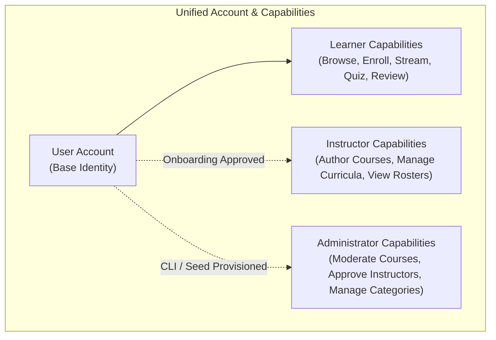
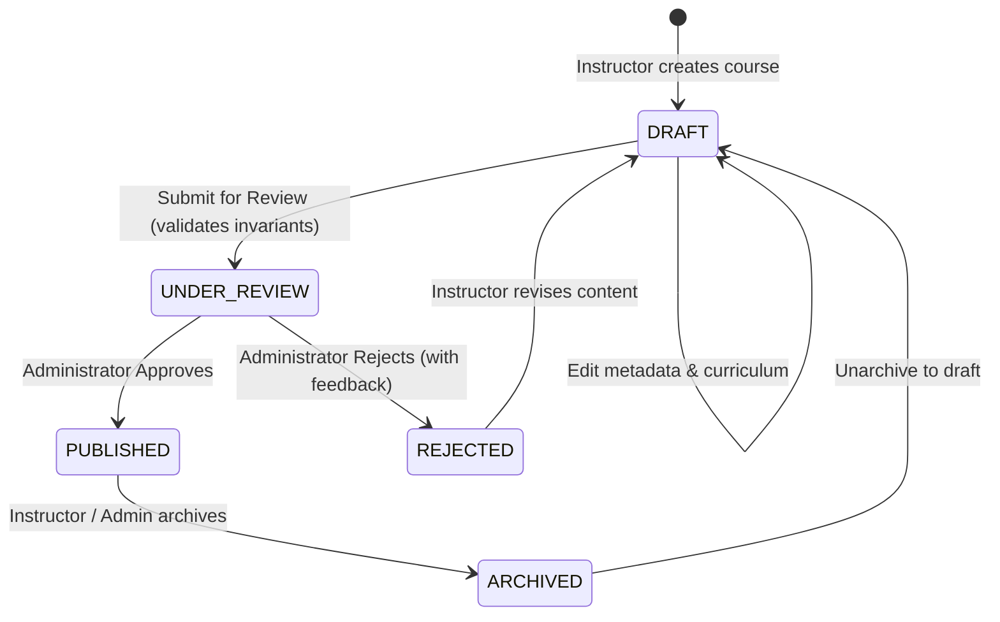
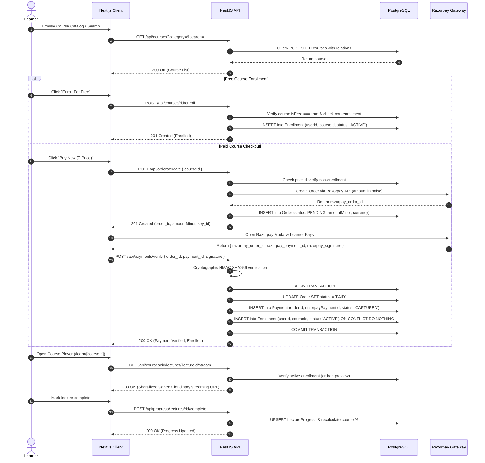
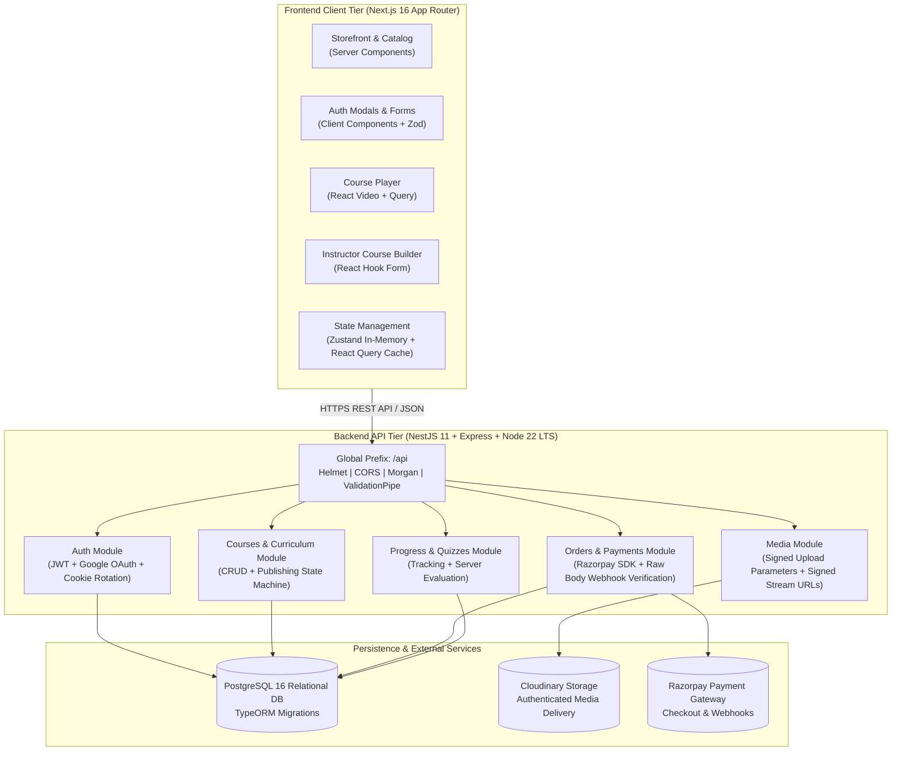
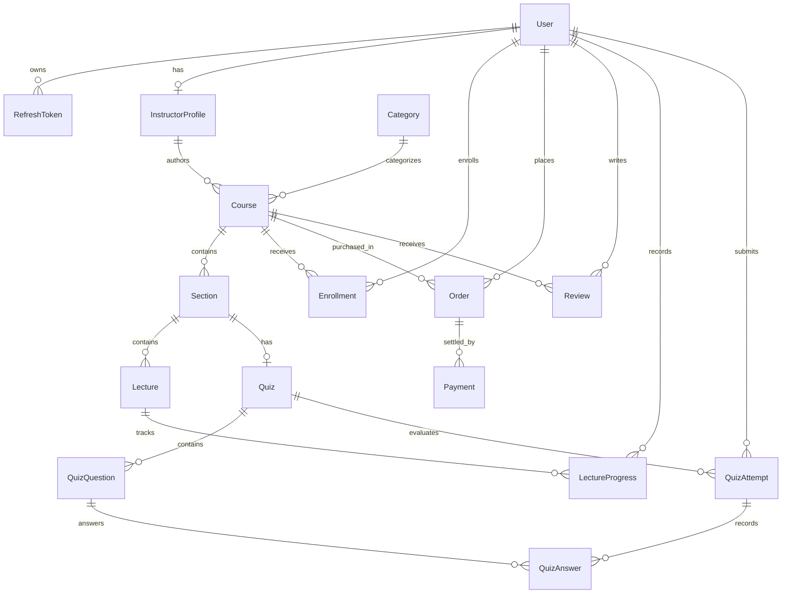
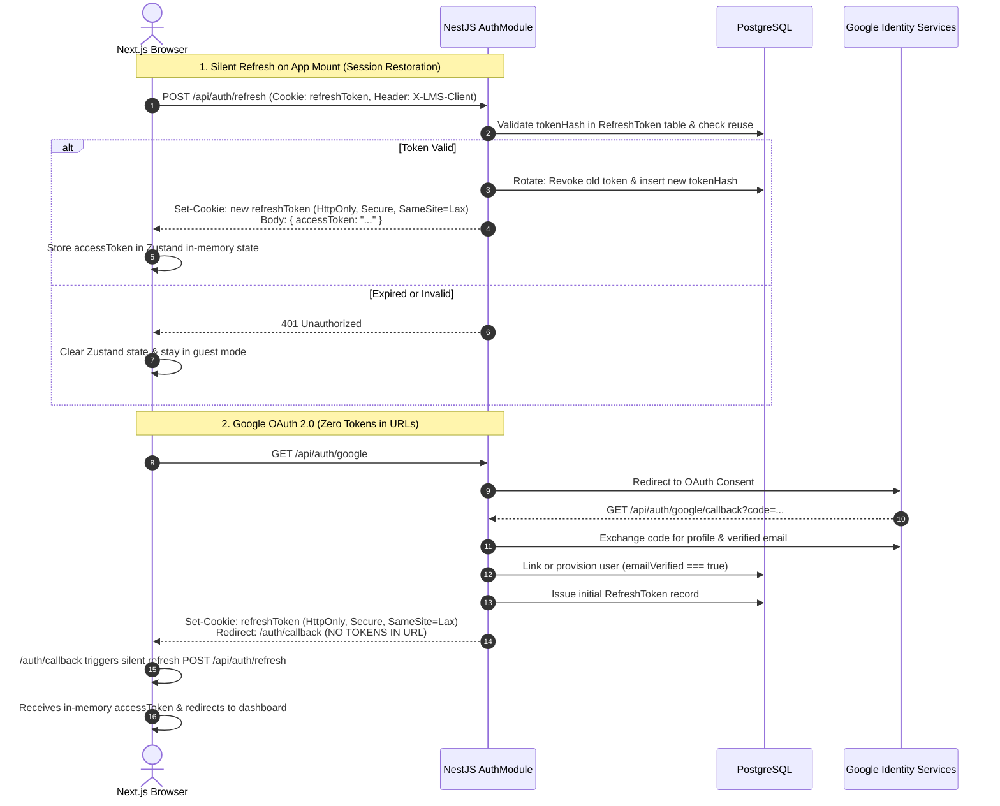
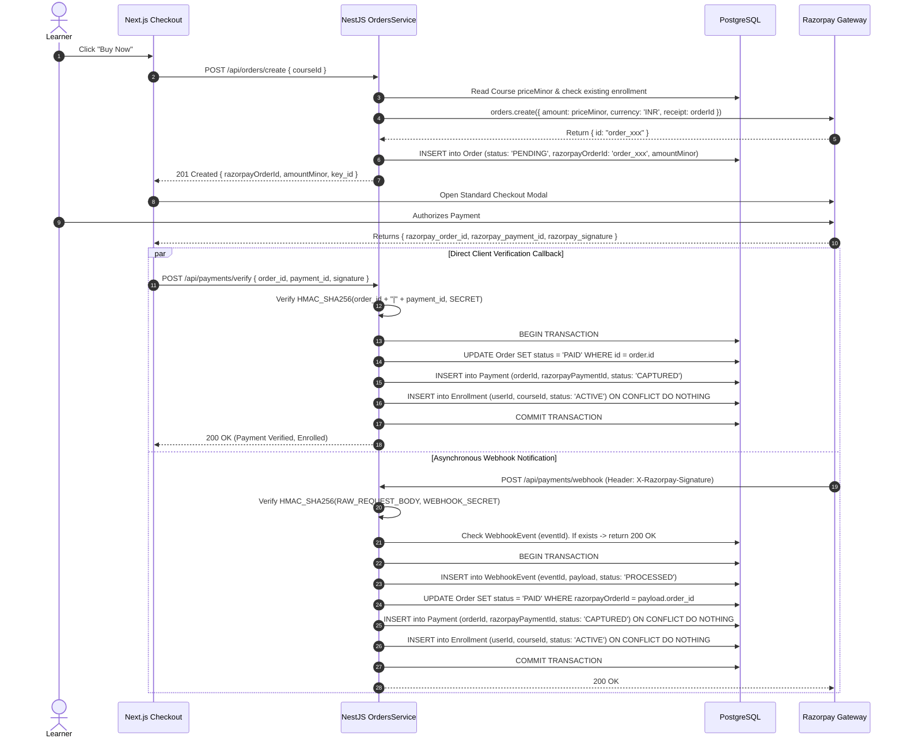
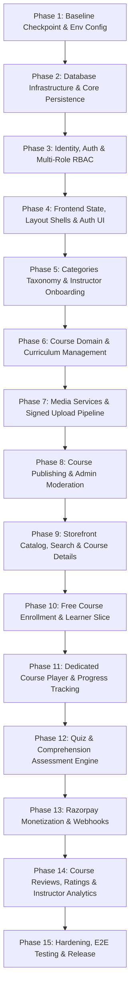
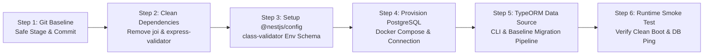

# LMS Platform — Master Implementation Plan & Production Architecture Blueprint

> **Document Type:** Canonical Master Development Plan  
> **Status:** Final Candidate — Awaiting Owner Approval  
> **Target System:** Full-Stack Online Learning Marketplace (Udemy Clone)  
> **Repository Path:** `C:\Users\Vikash\lms-platform`  
> **GitHub Remote:** `https://github.com/Vikash7t/lms-platform.git`  
> **Authoring Roles:** Principal Software Architect, Senior Product Manager, Technical Lead & QA Architect  
> **Date:** November 17, 2026  

---

## Document Overview & Executive Governance

This document serves as the **single source of truth and canonical architectural master plan** for the development of the **LMS Platform**. It consolidates, verifies, and supersedes all prior discovery reports and preliminary working documents. 

The primary objective is to transition the project from its current Day-0 scaffolding into a portfolio-grade, production-oriented online course marketplace inspired by Udemy and guided by the **Desi Stack** full-stack tutorial masterclass series.

---

# Table of Contents

1. [Executive Summary](#1-executive-summary)
2. [Confirmed Product Definition & Lifecycle](#2-confirmed-product-definition--lifecycle)
3. [Repository Audit and Actual Implementation Baseline](#3-repository-audit-and-actual-implementation-baseline)
4. [Source and Evidence Register](#4-source-and-evidence-register)
5. [Tutorial Installment and Feature Mapping](#5-tutorial-installment-and-feature-mapping)
6. [Current Implementation Gaps](#6-current-implementation-gaps)
7. [Product Workflows](#7-product-workflows)
8. [MVP and Future Scope](#8-mvp-and-future-scope)
9. [Recommended Technical Architecture](#9-recommended-technical-architecture)
10. [Database Model, Invariants & Entity Catalog](#10-database-model-invariants--entity-catalog)
11. [Authentication, Session Management & RBAC Plan](#11-authentication-session-management--rbac-plan)
12. [Media Delivery & Razorpay Payment Architecture](#12-media-delivery--razorpay-payment-architecture)
13. [UX and Frontend Structure](#13-ux-and-frontend-structure)
14. [Security, Reliability, and Production Readiness](#14-security-reliability-and-production-readiness)
15. [Phase-by-Phase Development Roadmap](#15-phase-by-phase-development-roadmap)
16. [First Implementation Batch](#16-first-implementation-batch)
17. [Testing Strategy](#17-testing-strategy)
18. [Risks, Assumptions, and Decision Register](#18-risks-assumptions-and-decision-register)
19. [Final Readiness Assessment](#19-final-readiness-assessment)

---

# 1. Executive Summary

### 1.1 Project Status & Current Reality
The repository currently represents an **early-stage foundation**. It contains a single Git repository housing two independent application directories (`backend` and `frontend`) without top-level monorepo tooling.
- **Backend:** NestJS 11 application bootstrapped with basic HTTP security middleware (Helmet, CORS, Morgan logger, and global `ValidationPipe`) in `backend/src/main.ts`, exposing a solitary boilerplate endpoint (`GET /api` returning `"Hello World!"`). Zero domain models, database entities, migrations, or authentication logic have been authored.
- **Frontend:** Next.js 16 (React 19, Tailwind CSS v4) application with 25 Shadcn UI component primitives installed in `frontend/components/ui/`. The application entry point (`frontend/app/page.tsx`) renders `"this is vikash"`. Crucially, the entire `frontend/` directory remains untracked in Git.

### 1.2 Core Objective
To engineer a clean, maintainable, portfolio-grade online learning marketplace that enables:
1. **Learners** to discover courses, enroll in free courses or purchase paid courses, consume video lectures with progress tracking, complete comprehension quizzes, and write verified reviews.
2. **Instructors** to onboard, build structured multi-section curricula, upload media, price courses, submit courses for review, and monitor student enrollment rosters.
3. **Administrators** to manage category taxonomies, review and moderate course submissions, approve instructor profiles, and oversee system health.

### 1.3 Implementation Philosophy
- **Pragmatic Repository Structure:** Retain the single Git repository with independent `backend` and `frontend` folders, avoiding the operational complexity of premature monorepo orchestration tools (Nx/Turborepo).
- **Production-Oriented Engineering:** Enforce strict migration-driven schema management (`synchronize: false`), direct-to-cloud signed media uploads, cryptographic payment signature verification, in-memory client access tokens with rotating HttpOnly refresh cookies, and vertical feature slices.

---

# 2. Confirmed Product Definition & Lifecycle

### 2.1 Multi-Role Persona & Capability Model
The platform avoids the single-role bottleneck. Every registered account has fundamental learner capabilities, with additive roles granted for instruction and administration:



1. **Learner (Student):**
   - Active on all accounts by default.
   - Discovers courses via faceted search, category filtering, and promotional previews.
   - Enrolls directly into free courses or purchases paid courses via Razorpay.
   - Streams authorized lecture video content with persistent progress tracking.
   - Completes embedded multiple-choice quizzes and receives evaluation reports.
   - Submits verified star ratings and reviews for enrolled courses.
2. **Instructor (Content Creator):**
   - Submits an instructor application profile (`PENDING`).
   - Once approved by an Administrator, gains access to the Instructor Portal without forfeiting their student enrollments or learner abilities.
   - Drafts, edits, and manages courses via a multi-step authoring wizard.
   - Builds hierarchical curricula composed of Sections and Lectures.
   - Uploads promotional thumbnails and large lecture videos via secure direct-to-Cloudinary signed pipelines.
   - Authors multiple-choice quizzes linked to curriculum sections.
   - Submits courses for administrator publication review.
   - Inspects enrolled student rosters and tracks student metrics.
3. **Administrator (Platform Operator):**
   - Oversees category taxonomy (creating, updating, and archiving course categories).
   - Reviews instructor onboarding applications (`PENDING` $\rightarrow$ `APPROVED` / `REJECTED`).
   - Moderates submitted courses (`UNDER_REVIEW` $\rightarrow$ `PUBLISHED` / `REJECTED`).
   - Inspects registered user records and monitors platform health.

### 2.2 Course Publishing & Moderation Lifecycle
Courses are governed by a formal 5-state lifecycle state machine, ensuring quality and administrative moderation prior to public catalog discovery:



- **Invariant Rules for Review Submission:** An instructor cannot transition a course from `DRAFT` to `UNDER_REVIEW` unless it satisfies:
  1. Title, subtitle, description, and primary category assigned.
  2. Promotional thumbnail URL present.
  3. Price configured ($\ge 0$).
  4. Minimum 1 `Section` containing at least 1 `Lecture` with valid media attached.

---

# 3. Repository Audit and Actual Implementation Baseline

### 3.1 Git Version Control Status
- **Current Branch:** `main` tracking `origin/main` (`https://github.com/Vikash7t/lms-platform.git`).
- **Commit History:** Exactly two commits exist:
  1. `b759593 chore: initialize LMS backend` (Aug 13, 2026) — Created NestJS starter.
  2. `c3b8e62 the frontend setup` (Aug 14, 2026) — Staged only `backend/package.json` and `backend/package-lock.json`.
- **Working Tree State:**
  - `frontend/`: **Untracked directory.** The entire frontend application (Next.js, Tailwind v4, 25 Shadcn components) is not committed to source control.
  - `backend/`: Has uncommitted modifications in `package.json`, `package-lock.json`, and `src/main.ts`.
  - `backend/.env`: Ignored by `.gitignore`, containing `FRONTEND_URL = http://localhost:3000` and `PORT = 8000`.

### 3.2 Repository Architecture Taxonomy
The repository is a **single Git repository containing separate backend and frontend applications without root workspace tooling**.
- It is **not a polyrepo** (both applications reside in one repository).
- It is **not a formal monorepo** with unified workspace management (there is no root `package.json`, pnpm-workspace, or Turborepo pipeline).
- Both sub-projects have independent `node_modules`, `package.json`, and build configurations.

### 3.3 Backend Technical Baseline
- **Framework & Runtime:** NestJS Core `11.1.29`, NestJS Common `11.0.1`, Express `5.0.0`, running on **Node.js 22 LTS** (Active LTS).
- **Language & Compiler:** TypeScript `5.9.3`, configured with modern `nodenext` module resolution (`target: ES2023`, `strictNullChecks: true`). Passes typecheck (`tsc --noEmit --incremental false`) with **0 errors**.
- **Bootstrap Pipeline (`backend/src/main.ts`):**
  - Security Headers: `helmet()` initialized.
  - CORS: Configured for `process.env.FRONTEND_URL || 'http://localhost:3000'` with `credentials: true`.
  - Logging: `morgan('combined')` HTTP request logger active.
  - Global Validation: Global `ValidationPipe` active with `transform: true`, `whitelist: true`, `forbidNonWhitelisted: true`.
  - Routing: Global prefix set to `api` (`http://localhost:8000/api`).
- **Implemented APIs:** Only `AppController` (`GET /api`) returning `"Hello World!"`. Zero LMS domain controllers, services, or DTOs.
- **Database & Persistence:**
  - Installed packages: `pg` (`8.23.0`), `typeorm` (`1.1.0`), `@nestjs/typeorm` (`11.0.3`).
  - Configuration status: `app.module.ts` contains `imports: []`. `TypeOrmModule.forRoot` is **not configured**. Zero entities, zero migrations, zero connection strings.
- **Authentication Packages:**
  - Installed packages: `passport` (`0.7.0`), `@nestjs/passport` (`11.0.5`), `passport-jwt` (`4.0.1`), `passport-google-oauth20` (`2.0.0`), `@nestjs/jwt` (`11.0.2`), `jsonwebtoken` (`9.0.3`), `bcryptjs` (`3.0.3`).
  - Implementation status: No Passport strategies, no auth controllers, no JWT guards authored.
- **Validation Packages:**
  - Concurrently installed: `class-validator` (`0.15.1`), `class-transformer` (`0.5.1`), `joi` (`18.2.3`), `express-validator` (`7.3.2`).
  - Note: `joi` and `express-validator` originated directly from the companion repository setup instructions, but are redundant in NestJS and will be removed.

### 3.4 Frontend Technical Baseline
- **Framework & Runtime:** Next.js `16.3.0` (App Router), React `19.2.8`, React DOM `19.2.8`.
- **Language & Compiler:** TypeScript `5.9.3`, path aliases `@/*` mapped to `./*`. Passes typecheck (`tsc --noEmit --incremental false`) with **0 errors**.
- **Styling Engine:** Tailwind CSS `4.3.3` via `@tailwindcss/postcss` and CSS `@theme inline` tokens in `app/globals.css`.
- **UI Components:** 25 primitives installed in `frontend/components/ui/` via Shadcn CLI (`4.18.0`) with `radix-nova` style (`accordion`, `alert`, `avatar`, `badge`, `button`, `card`, `carousel`, `checkbox`, `dialog`, `dropdown-menu`, `input`, `label`, `navigation-menu`, `pagination`, `progress`, `radio-group`, `scroll-area`, `select`, `separator`, `sheet`, `sidebar`, `skeleton`, `table`, `tabs`, `textarea`, `tooltip`).
- **Implemented Views:** Only `frontend/app/page.tsx` rendering `<div>this is vikash</div>`. Zero course pages, zero auth dialogs, zero dashboard shells.
- **State & Data Fetching:** Neither `@tanstack/react-query` nor `zustand` is installed. No API client (`lib/api.ts`) exists.

### 3.5 Testing Baseline
- **Backend Unit Tests:** `backend/src/app.controller.spec.ts` passes (`1/1 passed`) asserting `AppController.getHello()`.
- **Backend E2E Tests:** `backend/test/app.e2e-spec.ts` fails during execution:
  - *Observed Failure:* `connect EACCES 127.0.0.1:63721` due to operating system / sandbox port-binding restrictions during Supertest ephemeral socket allocation.
  - *Route Context:* The test fixture creates an in-memory `INestApplication` from `AppModule` without invoking `app.setGlobalPrefix('api')`. Within this fixture, `GET /` correctly matches the controller route, but it does not exercise the production `/api` route prefix configured in `main.ts`.
- **Frontend Tests:** Zero test runners or test files configured in `frontend/`.

---

# 4. Source and Evidence Register

### 4.1 Tutorial Reference Register
The project is inspired by the tutorial masterclass series published by **Desi Stack** (Dheeraj Agrahari). Crucially, the series currently consists of **four published installments**, with subsequent parts planned but not yet released:

| Source Identifier | Title | URL | Duration / Published Scope | Verified Status |
|---|---|---|---|---|
| **Tutorial Part 1** | Build an LMS Like Udemy \| Production-Level Full Stack Project \| Part 1 | [https://youtu.be/1VFzHIbDHwI](https://youtu.be/1VFzHIbDHwI) | ~9 hrs 23 min (16 published chapters) | Verified from published video description & chapters |
| **Tutorial Part 2** | Full Stack Udemy Clone: NestJS + Next.js + PostgreSQL Masterclass (Part 2) | [https://youtu.be/5ZhhBD4MfGY](https://youtu.be/5ZhhBD4MfGY) | ~10 hrs | Verified from published video overview & companion repo |
| **Tutorial Part 3** | Build a Complete LMS Portal with Admin Panel \| Full Stack Project \| Next.js + NestJS \| Part 3 | [https://youtu.be/LeEQOvt9ojA](https://youtu.be/LeEQOvt9ojA) | ~8–10 hrs | Verified from published title, video overview & UI demos |
| **Tutorial Part 4** | Build a Complete LMS Portal with Admin Panel & Razorpay Payments \| Next.js + NestJS \| Part 4 | [https://youtu.be/5GN2FswYJoI](https://youtu.be/5GN2FswYJoI) | ~8–10 hrs | Verified from published title, checkout flow & Razorpay logic |
| **Companion Repo** | LMS Platform Data (Starter & Seed Files) | [https://github.com/agraharidheeraj/lms-platform-data](https://github.com/agraharidheeraj/lms-platform-data) | Repository README & `SETUP.md` | Verified companion setup guide and dependency lists |
| **Subsequent Parts** | Part 5+ (Advanced Deployments / Certificates / Polish) | N/A | In-progress / Not yet published | **Unpublished series installments**; not assumed as existing code |

### 4.2 Companion Repository (`SETUP.md`) Provenance
Inspection of the companion repository's `SETUP.md` reveals the exact origin of local dependencies:
1. **Validation Packages:** The setup guide specifies `npm i class-validator class-transformer joi express-validator`. The local presence of `joi` and `express-validator` is **not an accidental developer addition**, but directly copied from the creator's setup snippet. They are redundant in NestJS and will be cleanly removed.
2. **Additional Packages in Setup Guide (Not Yet Installed Locally):**
   - `@nestjs/config` (environment management)
   - `cloudinary`, `multer`, `@types/multer` (media upload pipeline)
   - `razorpay` (payment processing SDK)
   - `@tanstack/react-query`, `zustand`, `axios` (frontend state & API communication)
   - `pdfkit` / PDF generation utilities (certificate issuance referenced in guide)

---

# 5. Tutorial Installment and Feature Mapping

The following matrix maps features demonstrated across the tutorial series to the local implementation baseline:

| Tutorial Installment | Feature / Domain Milestone | Video Evidence / Timestamp | Companion Repo Evidence | Local Repository Status | Implementation Action Required |
|---|---|---|---|---|---|
| **Part 1** | Backend NestJS Initial Setup | `26:20` | `SETUP.md` | **Confirmed / Implemented** | Baseline exists in `backend/src/main.ts`. |
| **Part 1** | HTTP Security & Middleware (Helmet, CORS, Morgan) | `38:00 - 45:00` | `SETUP.md` | **Confirmed / Implemented** | Wired up in `backend/src/main.ts`. |
| **Part 1** | Next.js App Router Scaffolding | `45:00 - 55:00` | `SETUP.md` | **Partially Implemented** | Files exist but untracked in Git; commit needed. |
| **Part 1** | Shadcn UI Components Installation | `55:00 - 01:12:00` | `components.json` | **Confirmed / Implemented** | 25 primitives present in `frontend/components/ui/`. |
| **Part 1** | PostgreSQL Database Connection | `01:12:50` | `SETUP.md` (`pg`, `typeorm`) | **Missing / Unconfigured** | Configure `TypeOrmModule.forRootAsync` in backend. |
| **Part 1** | User & Instructor Entities + DTOs | `01:29:51` | `User`, `Instructor` models | **Missing** | Author entities in `src/modules/users/entities/`. |
| **Part 1** | TypeORM Migrations Pipeline | `02:33:33` | Migration scripts | **Missing** | Configure TypeORM data-source and migration scripts. |
| **Part 1** | Auth Module (JWT, Local & Google OAuth) | `02:53:58` | Auth controllers & guards | **Missing** | Implement `AuthModule`, strategies, and guards. |
| **Part 1** | User Profile APIs & Services | `04:34:16` | User endpoints | **Missing** | Implement `UsersModule` CRUD operations. |
| **Part 1** | React Query & Zustand Setup | `05:07:10` | `SETUP.md` | **Missing / Not Installed** | Install packages; setup QueryClient and auth store. |
| **Part 1** | Storefront Header, Auth Modal & Login | `06:01:10 - 06:35:06` | Auth dialog components | **Missing** | Author Navbar, LoginDialog, and RegisterDialog. |
| **Part 1** | Home Page Showcase & Ecosystem Pages | `08:15:58 - 09:07:21` | Hero, Footer, About, Terms | **Missing** | Build public landing page and static pages. |
| **Part 2** | Dashboard Shell Layouts (Sidebar/Header) | Video Overview | Dashboard components | **Missing** | Create `app/(dashboard)/layout.tsx` using `sidebar.tsx`. |
| **Part 2** | Instructor Onboarding Flow | Video Overview | Instructor profile entity | **Missing** | Build onboarding wizard and status updates. |
| **Part 2** | Category Taxonomy & Course Entities | Video Overview | `Category`, `Course` models | **Missing** | Create entities, relations, and category APIs. |
| **Part 2** | Course Listing APIs & Media Services | Video Overview | `SETUP.md` (Cloudinary, Multer) | **Missing** | Implement `CoursesModule` and `MediaModule`. |
| **Part 3** | Instructor Dashboard & Course Wizard | Video Overview | Course builder forms | **Missing** | Build frontend course creation wizard. |
| **Part 3** | Curriculum Builder (Sections & Lectures) | Video Overview | Section/Lecture models | **Missing** | Implement curriculum management with order indices. |
| **Part 3** | Interactive Quiz Builder | Video Overview | `Quiz`, `Question` models | **Missing** | Build assessment models and quiz builder UI. |
| **Part 4** | Public Course Details Page | Video Overview | Course landing UI | **Missing** | Build `/courses/[slug]` view with video preview. |
| **Part 4** | Student Enrollment Workflow | Video Overview | `Enrollment` entity | **Missing** | Create enrollment tracking and access logic. |
| **Part 4** | Course Reviews & Star Ratings | Video Overview | `Review` entity & UI | **Missing** | Author review submission and display components. |
| **Part 4** | Instructor Student Management | Video Overview | Student roster tables | **Missing** | Implement enrolled student table using `table.tsx`. |
| **Part 4** | Razorpay Payment Gateway Integration | Video Overview | `SETUP.md` (`razorpay`) | **Missing** | Implement order creation, checkout modal, verification. |

---

# 6. Current Implementation Gaps

| Architectural Domain | Current Repository State | Target Production State | Gap Severity |
|---|---|---|---|
| **Source Control** | `frontend/` untracked on disk; uncommitted backend files | All files tracked on branch `main` with clean working tree | **Critical** |
| **Database & ORM** | PostgreSQL and TypeORM installed in `package.json` but unconfigured | Active connection pool via `TypeOrmModule`, 17 relational entities, automated migrations | **Critical** |
| **Identity & Access** | Passport/JWT packages installed; zero strategies or guards | Complete JWT auth, Google OAuth, HttpOnly cookie rotation, role-based guards | **Critical** |
| **Course Domain** | Zero course-related models, services, or controllers | Full curriculum hierarchy (Category $\rightarrow$ Course $\rightarrow$ Section $\rightarrow$ Lecture) | **Critical** |
| **Monetization** | No payment packages installed; no checkout logic | Razorpay order creation, frontend modal, webhook deduplication, HMAC verification | **High** |
| **Media Delivery** | No file handling middleware or storage SDKs installed | Direct signed Cloudinary video upload pipeline + signed stream authorization URLs | **High** |
| **Frontend Routing & UI**| Single root page rendering `"this is vikash"`; 25 unused UI primitives | Storefront, Learner Dashboard, Instructor Portal, Course Player layouts | **High** |
| **Client State / Fetching**| Neither React Query nor Zustand installed; no API client | TanStack React Query for server cache, Zustand for in-memory session, Axios client | **High** |
| **Testing** | 1 unit test passing; E2E test fails on sandbox port restriction | Jest unit/integration tests; Vitest component tests; Playwright E2E suites | **Medium** |
| **DevOps & Release** | No Docker, no CI/CD pipelines, no environment schemas | `docker-compose.yml` for local DB, Dockerfile, verified Node.js 22 LTS runtime | **Medium** |

---

# 7. Product Workflows

### 7.1 Learner Journey (Free vs. Paid Enrollment)



### 7.2 Instructor Journey
1. **Onboarding:** User with base account submits instructor application $\rightarrow$ `InstructorProfile` created with status `PENDING`.
2. **Administrative Approval:** Administrator inspects application in Admin Portal and approves it $\rightarrow$ status becomes `APPROVED`; user's `roles` array gains `INSTRUCTOR`.
3. **Course Authoring:** Instructor accesses `/instructor/courses/create` $\rightarrow$ enters metadata $\rightarrow$ creates `Course` in `DRAFT` status.
4. **Curriculum Builder:** Instructor creates Sections $\rightarrow$ adds Lectures $\rightarrow$ attaches video media using direct-to-Cloudinary signed uploads and enters textual notes.
5. **Quiz Builder:** Instructor creates Section quizzes $\rightarrow$ defines multiple-choice questions with answer options (correct answers stored exclusively on backend).
6. **Publication Review Request:** Instructor clicks "Submit for Review" $\rightarrow$ backend validates invariants $\rightarrow$ course status transitions to `UNDER_REVIEW`.
7. **Approval & Monitoring:** Once an Administrator approves the submission (`PUBLISHED`), the course goes live on the marketplace. Instructor monitors enrolled student rosters via `/instructor/courses/:id/students`.

### 7.3 Administrator Journey
1. **Initial Provisioning:** Initial Administrator account is provisioned securely via CLI seed command using environment variables (`npm run seed:admin`), never through public endpoints.
2. **Category Governance:** Admin creates, updates, and archives categories via `/admin/categories`.
3. **Instructor Approval:** Admin reviews pending instructor applications via `/admin/instructors`, verifying professional details.
4. **Course Moderation:** Admin evaluates courses in `UNDER_REVIEW` state via `/admin/courses/moderation`, either approving (`PUBLISHED`) or rejecting with revision feedback (`REJECTED`).

---

# 8. MVP and Future Scope

| Scope Category | Included Features | Rationale |
|---|---|---|
| **MVP (Core Marketplace)** | • Email/password & Google OAuth 2.0 with rotating HttpOnly refresh cookies<br/>• Multi-role capability model (Learner, Instructor, Admin)<br/>• Administrative instructor onboarding review (`PENDING` $\rightarrow$ `APPROVED`)<br/>• Course creation wizard & hierarchical curriculum editor (Sections/Lectures)<br/>• Direct signed Cloudinary media upload (images $\le$ 5MB, videos $\le$ 1GB)<br/>• Protected lecture streaming with backend-signed short-lived URLs<br/>• Course publishing review workflow (`DRAFT` $\rightarrow$ `UNDER_REVIEW` $\rightarrow$ `PUBLISHED`)<br/>• Public storefront catalog, faceted search, and course detail preview<br/>• Direct free course enrollment & Razorpay paid checkout with raw-body HMAC verification<br/>• Webhook deduplication and multi-payment attempt tracking<br/>• Distraction-free video player with lecture progress tracking<br/>• Interactive quizzes with secure server-side answer evaluation<br/>• Verified student course reviews and ratings<br/>• Instructor student roster tables | Defines the complete viable online learning marketplace matching the tutorial reference. Delivers an end-to-end usable product with production-grade security. |
| **Next (Fast Follows)** | • Automated PDF certificate generation upon 100% course completion<br/>• Password reset via email transport (Nodemailer / Resend)<br/>• Downloadable lesson resource attachments (PDF/ZIP)<br/>• Instructor revenue analytics dashboard | Enhances learner satisfaction and administrative utility without complicating core transaction flows. |
| **Later (Platform Scale)** | • Adaptive bitrate video streaming (HLS transcoding via Cloudflare Stream or Mux)<br/>• Promotional coupons and course bundle discounts<br/>• Automated instructor payout disbursements<br/>• Lecture Q&A discussion forums per video | High-complexity infrastructure features suited for post-launch scaling. |
| **Out of Scope (Excluded)** | • Real-time live video conferencing / Zoom integration<br/>• AI-generated course curricula or automated video dubbing<br/>• Multi-tenant enterprise corporate LMS portals<br/>• SCORM / xAPI legacy e-learning package ingestion<br/>• Microservice decomposition | Unjustified architectural complexity for this portfolio project. |

---

# 9. Recommended Technical Architecture

### 9.1 High-Level Architecture Diagram



### 9.2 Backend Architectural Standards
- **Framework Structure:** Idiomatic NestJS modular architecture. Every domain feature encapsulates a dedicated module (`*.module.ts`), controller (`*.controller.ts`), service (`*.service.ts`), entity definitions (`*.entity.ts`), and DTOs (`dto/*.dto.ts`).
- **Configuration Management:** Centralized `@nestjs/config` module loading `backend/.env`. Validated at startup using a custom `validate` function powered by `class-validator` and `class-transformer` (`EnvironmentVariables` class with `@IsString()`, `@IsNumber()`, `@IsUrl()`). Fails fast if mandatory secrets are missing.
- **Validation Pipeline:** Enforce validation exclusively via standard `class-validator` decorators and NestJS `ValidationPipe` with `whitelist: true` and `forbidNonWhitelisted: true`. Redundant `joi` and `express-validator` packages are removed.
- **Error Handling & Response Schema:** Global `HttpExceptionFilter` ensuring uniform JSON error responses:
  ```json
  {
    "statusCode": 400,
    "message": "Validation failed",
    "errors": ["priceMinor must be an integer"],
    "timestamp": "2026-11-17T19:00:00.000Z",
    "path": "/api/courses"
  }
  ```

### 9.3 Frontend Architectural Standards
- **Next.js App Router Structure:**
  - `app/(storefront)/`: Public course discovery, search, course landing page, static ecosystem pages.
  - `app/(dashboard)/student/`: Enrolled courses, learning history, profile settings.
  - `app/(dashboard)/instructor/`: Course management, authoring wizard, student rosters.
  - `app/(dashboard)/admin/`: Category management, instructor applications, course moderation.
  - `app/learn/[courseId]/`: Distraction-free learning viewer with collapsible curriculum sidebar and video player.
- **State Separation of Concerns:**
  - **TanStack React Query:** Manages all **server-state** (fetching course lists, caching query results, handling mutation lifecycles, and cache invalidation).
  - **Zustand:** Manages strictly **client-state** (in-memory access token, current video player layout state, sidebar collapse status). No sensitive tokens are stored in `localStorage` or `sessionStorage`.

---

# 10. Database Model, Invariants & Entity Catalog

### 10.1 Entity Relationship Diagram



### 10.2 Relational Entity Catalog (Exactly 17 Entities)

| Entity # | Entity Name | Primary Key | Key Fields, Constraints & Enums | Relationships |
|---|---|---|---|---|
| **1** | **User** | `id` (UUID) | `email` (unique), `passwordHash` (nullable for OAuth), `googleId` (nullable, unique), `roles` (enum array: `LEARNER`, `INSTRUCTOR`, `ADMIN`), `firstName`, `lastName`, `avatarUrl`, `isEmailVerified` (bool), `createdAt` | 1:N with `RefreshToken`, 1:1 with `InstructorProfile`, 1:N with `Enrollment`, `Order`, `Review`, `LectureProgress`, `QuizAttempt` |
| **2** | **RefreshToken** | `id` (UUID) | `userId` (FK), `tokenHash` (unique), `familyId` (UUID), `isRevoked` (bool), `expiresAt` (timestamp), `createdAt` | N:1 with `User` |
| **3** | **InstructorProfile** | `id` (UUID) | `userId` (FK, unique), `bio`, `headline`, `websiteUrl`, `status` (enum: `PENDING`, `APPROVED`, `REJECTED`), `approvedAt`, `rejectionReason` | 1:1 with `User`, 1:N with `Course` |
| **4** | **Category** | `id` (UUID) | `name` (unique), `slug` (unique), `description`, `iconName` | 1:N with `Course` |
| **5** | **Course** | `id` (UUID) | `title`, `slug` (unique), `description`, `instructorId` (FK), `categoryId` (FK), `priceMinor` (integer, in paise), `currency` (default 'INR'), `isFree` (bool), `status` (enum: `DRAFT`, `UNDER_REVIEW`, `PUBLISHED`, `REJECTED`, `ARCHIVED`), `rejectionReason`, `thumbnailUrl`, `promoVideoUrl`, `publishedAt` | N:1 with `InstructorProfile`, N:1 with `Category`, 1:N with `Section`, `Enrollment`, `Review`, `Order` |
| **6** | **Section** | `id` (UUID) | `courseId` (FK), `title`, `orderIndex` (int) | N:1 with `Course`, 1:N with `Lecture`, 1:1 with `Quiz` |
| **7** | **Lecture** | `id` (UUID) | `sectionId` (FK), `title`, `videoUrl`, `publicId`, `duration` (int seconds), `content` (text), `isFreePreview` (bool), `orderIndex` (int) | N:1 with `Section`, 1:N with `LectureProgress` |
| **8** | **Quiz** | `id` (UUID) | `sectionId` (FK, unique), `title`, `passingScore` (int) | 1:1 with `Section`, 1:N with `QuizQuestion`, 1:N with `QuizAttempt` |
| **9** | **QuizQuestion** | `id` (UUID) | `quizId` (FK), `questionText`, `options` (jsonb array), `correctOptionIndex` (int, hidden from learner API), `explanation` (text) | N:1 with `Quiz`, 1:N with `QuizAnswer` |
| **10** | **QuizAttempt** | `id` (UUID) | `quizId` (FK), `userId` (FK), `score` (int), `isPassed` (bool), `submittedAt` (timestamp) | N:1 with `Quiz`, N:1 with `User`, 1:N with `QuizAnswer` |
| **11** | **QuizAnswer** | `id` (UUID) | `attemptId` (FK), `questionId` (FK), `selectedOptionIndex` (int), `isCorrect` (bool) | N:1 with `QuizAttempt`, N:1 with `QuizQuestion` |
| **12** | **Enrollment** | `id` (UUID) | `userId` (FK), `courseId` (FK), `enrolledAt` (timestamp), `status` (enum: `ACTIVE`, `REVOKED`), **UNIQUE `(userId, courseId)`** | N:1 with `User`, N:1 with `Course` |
| **13** | **Order** | `id` (UUID) | `userId` (FK), `courseId` (FK), `amountMinor` (integer snapshot), `currency` (char 3), `status` (enum: `PENDING`, `PAID`, `FAILED`), `razorpayOrderId` (unique) | N:1 with `User`, N:1 with `Course`, 1:N with `Payment` |
| **14** | **Payment** | `id` (UUID) | `orderId` (FK), `razorpayPaymentId` (unique), `razorpaySignature`, `amountMinor` (int), `status` (enum: `PENDING`, `CAPTURED`, `FAILED`), `errorCode`, `errorDescription`, `capturedAt` | N:1 with `Order` (supports multiple payment attempts) |
| **15** | **WebhookEvent** | `id` (UUID) | `provider` (default 'RAZORPAY'), `eventId` (unique), `eventType`, `payload` (jsonb), `status` (enum: `PROCESSED`, `FAILED`, `IGNORED`), `processedAt` | Standalone deduplication log |
| **16** | **Review** | `id` (UUID) | `userId` (FK), `courseId` (FK), `rating` (int 1–5), `comment` (text), `createdAt`, **UNIQUE `(userId, courseId)`** | N:1 with `User`, N:1 with `Course` |
| **17** | **LectureProgress** | `id` (UUID) | `userId` (FK), `lectureId` (FK), `isCompleted` (bool), `completedAt`, **UNIQUE `(userId, lectureId)`** | N:1 with `User`, N:1 with `Lecture` |

### 10.3 Business Invariants & Integrity Constraints
1. **Protected Media Authorization:** A learner cannot access a non-preview lecture's video stream without an active record in `Enrollment` (`status = 'ACTIVE'`) for that course.
2. **Integer Minor Currency Units:** All financial fields (`Course.priceMinor`, `Order.amountMinor`, `Payment.amountMinor`) are stored strictly as integers in minor currency units (e.g., paise: ₹499.00 = `49900`), eliminating IEEE-754 floating-point inaccuracies.
3. **Multiple Payment Attempts per Order:** An `Order` has a 1-to-many relationship with `Payment`. If a learner's initial payment attempt fails, subsequent attempts link to the same `Order` record until captured or expired.
4. **Quiz Answer Obfuscation:** The field `correctOptionIndex` and answer explanations must be omitted from learner-facing quiz APIs. Answers are evaluated solely on the backend upon submission.
5. **Idempotent Purchase Fulfillment & Webhook Deduplication:** Every webhook event is registered in `WebhookEvent` by unique `eventId`. If already processed, the system returns HTTP 200 immediately. Payment capture and enrollment creation execute in an atomic database transaction.
6. **Curriculum Ownership Isolation:** Instructors can only create, modify, or delete curriculum records belonging to courses they own.
7. **Publishing Validation Invariant:** A course cannot enter `UNDER_REVIEW` or `PUBLISHED` without at least one section containing at least one lecture with media.
8. **Progress Uniqueness:** At most one `LectureProgress` record per `(userId, lectureId)`. Course completion is derived as:
   $$\text{Progress \%} = \left(\frac{\sum \text{Completed Lectures}}{\text{Total Published Lectures in Course}}\right) \times 100$$
9. **Review Eligibility:** A user can submit a `Review` only if they hold an active `Enrollment`. Maximum one review per `(userId, courseId)`.

---

# 11. Authentication, Session Management & RBAC Plan

### 11.1 Identity & Session Architecture



- **Short-Lived Access Tokens:** Expire in 15 minutes. Contains `{ sub: user.id, email: user.email, roles: user.roles }`. Stored strictly **in-memory** in the frontend Zustand store (`store/auth.ts`). Never persisted to `localStorage` or `sessionStorage`.
- **HttpOnly Refresh Cookies:** Expire in 7 days. Configured with `httpOnly: true`, `secure: true` (in production), `sameSite: 'lax'`, and `path: '/api/auth'`.
- **Refresh Token Rotation & Revocation:** Every refresh call invalidates the presented refresh token and issues a new token pair belonging to the same `familyId`. If an already revoked token is presented (reuse attack), the backend revokes the entire `familyId`, invalidating all sessions for that compromised chain.
- **CSRF Defense:** Standard API mutation calls require the `Authorization: Bearer <accessToken>` header, which browsers never send automatically in cross-site requests. For cookie-authenticated endpoints (`/api/auth/refresh`, `/api/auth/logout`), the API requires a custom application header (`X-LMS-Client: web`), which browsers disallow cross-origin without explicit CORS preflight consent.
- **Verified Google Email & Account Linking:** Google OAuth checks `profile.emails[0].verified === true`. If the user already registered with credentials using the exact verified email, the account automatically links `googleId` without creating duplicate accounts.
- **Secure Administrator Provisioning:** The first Administrator is provisioned via an offline CLI seed script (`npm run seed:admin`), reading `ADMIN_EMAIL` and `ADMIN_INITIAL_PASSWORD` from `.env`. No public registration endpoint ever grants the `ADMIN` role.

---

# 12. Media Delivery & Razorpay Payment Architecture

### 12.1 Media Upload & Protected Delivery Pipeline
To prevent memory crashes from buffering large video files via Multer memory storage, the architecture divides media into two distinct pipelines:

```mermaid
flowchart LR
    subgraph Client ["Client Browser"]
        Uploader["Upload Component"]
        Player["Video Player"]
    end

    subgraph Backend ["NestJS API"]
        Signer["Media Signer Service"]
        StreamAuth["Stream Authorization Service"]
    end

    subgraph Cloudinary ["Cloudinary Cloud"]
        CloudDirect["Chunked Direct Video Storage<br/>(Authenticated / Private)"]
        Thumbnails["Image Storage<br/>(Thumbnails & Avatars)"]
    end

    Uploader -->|1. Request Upload Signature| Signer
    Signer -->>|2. Signed Params & Timestamp| Uploader
    Uploader -->|3. Direct Chunked Upload| CloudDirect
    Uploader -->|4. Confirm PublicID & Duration| Backend

    Player -->|1. Request Stream URL| StreamAuth
    StreamAuth -->|2. Verify Active Enrollment| StreamAuth
    StreamAuth -->>|3. Short-Lived Signed Delivery URL| Player
    Player -->|4. Stream Video| CloudDirect
```

1. **Images (Thumbnails & Avatars $\le$ 5MB):** Handled via Multer disk storage (or signed direct upload). Validated for MIME types (`image/jpeg`, `image/png`, `image/webp`). Streamed to Cloudinary folder `lms/thumbnails`.
2. **Lecture Videos (Videos $\le$ 1GB):** **Direct Client-to-Cloudinary Signed Chunked Upload**:
   - Client requests upload parameters: `POST /api/media/video/sign-upload`.
   - Backend verifies instructor course ownership and returns an HMAC SHA1 signature, upload preset, timestamp, and target folder `lms/videos`.
   - Client uploads video directly to Cloudinary using chunked upload (`cloudinary.createUploadWidget` or chunked HTTP upload). The NestJS backend memory and bandwidth are never blocked by video buffers.
   - Client notifies backend: `POST /api/media/video/confirm` with `publicId`, `duration`, and `format`. Backend validates via Cloudinary API and updates `Lecture`.
3. **Protected Video Delivery:** Public HTTPS URLs are not sufficient proof of authorization. All videos are stored with Cloudinary delivery type `authenticated` or `private`. When an enrolled student requests playback (`GET /api/courses/:id/lectures/:lectureId/stream`):
   - Backend verifies `Enrollment` status (`status = 'ACTIVE'`) or checks `lecture.isFreePreview === true`.
   - Backend generates an ephemeral, short-lived (1-hour) signed Cloudinary streaming URL (`cloudinary.utils.sign_url(...)`).
   - Unauthorized users or expired links are rejected with HTTP 403 Forbidden.

### 12.2 Razorpay Payment Lifecycle & Distributed Boundaries
Razorpay external network calls and PostgreSQL local transactions cannot be atomically combined into a single database transaction. The lifecycle manages state explicitly:



- **Raw Request Body Webhook Verification:** The webhook signature must be verified against the exact, unparsed raw HTTP request buffer (`rawBody: Buffer` configured via NestJS `rawBody: true`), preventing payload alteration false-negatives.
- **Payment Retries:** If a payment attempt fails, Razorpay returns an error; the backend logs a `Payment` record with `status: 'FAILED'`, keeping the `Order` in `PENDING` status to allow retry attempts.

---

# 13. UX and Frontend Structure

### 13.1 Layout Shells
1. **Public Storefront Shell (`app/(storefront)/layout.tsx`):** Sticky header navigation with search input, category dropdown menu, "Become an Instructor" link, and Login/Signup triggers; footer with legal and informative links.
2. **Learner Dashboard Shell (`app/(dashboard)/student/layout.tsx`):** Sub-navigation tabs: "My Enrolled Courses", "Learning History", "Profile Settings".
3. **Instructor Dashboard Shell (`app/(dashboard)/instructor/layout.tsx`):** Collapsible sidebar layout utilizing `frontend/components/ui/sidebar.tsx` with links to "Courses", "Analytics", "Student Roster", "Profile".
4. **Admin Dashboard Shell (`app/(dashboard)/admin/layout.tsx`):** Sidebar navigation for "Categories", "Course Moderation", "Users", "Instructor Applications".
5. **Course Player Shell (`app/learn/[courseId]/layout.tsx`):** Distraction-free full-screen layout. Top bar with course title and progress percentage; collapsible right sidebar displaying section accordion and lecture checklist; central viewing canvas for video streaming and lesson text.

### 13.2 Route Hierarchy Matrix

| Route Path | Access Control | Primary Layout Shell | Main Components Used |
|---|---|---|---|
| `/` | Public | Storefront Shell | Hero banner, Category grid, Course carousel (`carousel.tsx`) |
| `/courses` | Public | Storefront Shell | Course search, Category filters, Course card grid (`card.tsx`, `badge.tsx`) |
| `/courses/[slug]` | Public | Storefront Shell | Course details, Preview video, Curriculum outline (`accordion.tsx`), Buy button |
| `/login` / `/register` | Public (Guest) | Centered Card Shell | Auth forms (`input.tsx`, `button.tsx`, `label.tsx`, `alert.tsx`) |
| `/dashboard/student` | Authenticated (Learner) | Learner Dashboard Shell | Enrolled course cards, Progress bars (`progress.tsx`) |
| `/learn/[courseId]` | Enrolled Student / Owner | Distraction-Free Player | Custom HTML5 Video Player, Lecture checklist, Quiz modal |
| `/instructor/courses` | Instructor / Admin | Instructor Sidebar Shell | Course table (`table.tsx`, `badge.tsx`), "New Course" button |
| `/instructor/courses/create` | Instructor / Admin | Instructor Sidebar Shell | Multi-step course creation wizard (`tabs.tsx`, `input.tsx`, `select.tsx`) |
| `/instructor/courses/[id]/curriculum` | Instructor (Owner) | Instructor Sidebar Shell | Curriculum builder, Section/Lecture manager, Quiz creator |
| `/admin/categories` | Admin Only | Admin Sidebar Shell | Category management table (`table.tsx`, `dialog.tsx`) |
| `/admin/courses/moderation` | Admin Only | Admin Sidebar Shell | Platform course moderation table, Status toggles, Rejection modal |

---

# 14. Security, Reliability, and Production Readiness

### 14.1 Security Categorization & Mitigation Matrix

| Security Area | Current Assessment | Production Mitigation Requirement |
|---|---|---|
| **CORS Configuration** | Default origin in `main.ts` falls back to `http://localhost:3000`. | Restrict CORS strictly to verified `FRONTEND_URL` environment variables in production. Disallow wildcard origins with credentials. |
| **Authentication & Secrets** | Secrets stored in `.env`. | Enforce startup validation via `@nestjs/config` and `class-validator`. Never commit secrets to Git. |
| **Password Handling** | Registrations require secure hashing. | Hash all credentials via `bcryptjs` (salt rounds: 10). Enforce password complexity via DTO validation. |
| **Route & Resource Authorization** | Domain endpoints must prevent unauthorized access. | Apply `JwtAuthGuard` and `RolesGuard`. Validate instructor ownership on all mutation endpoints. |
| **Payment Verification** | Prevent fraudulent enrollment. | Enforce cryptographic signature verification (`crypto.createHmac`) using raw request body in backend before enrollment insertion. |
| **SQL Injection** | Ensure parameterized queries. | Utilize TypeORM repositories and parameterized query builders; never concatenate raw SQL strings. |
| **File Upload Validation** | Prevent malicious file uploads. | Validate MIME types, enforce size limits (5 MB images, 1 GB videos), and stream directly to Cloudinary. |
| **Rate Limiting** | Protect authentication endpoints. | Implement `@nestjs/throttler` on `/api/auth/*` routes to prevent brute-force credential stuffing. |

---

# 15. Phase-by-Phase Development Roadmap

The development roadmap is organized into **15 logically ordered vertical phases**. Each phase produces a complete, functional slice of capability:



---

### Detailed Phase Specifications

#### Phase 1: Baseline Checkpoint & Environment Configuration
- **Objective:** Secure untracked files into source control, remove redundant validation packages, and configure runtime environment validation.
- **Dependencies:** None.
- **Backend Work:** In `backend/package.json`, remove redundant packages (`joi`, `express-validator`, `jsonwebtoken`). Install `@nestjs/config`. Create `src/config/env.validation.ts` using `class-validator` to enforce required variables (`PORT`, `FRONTEND_URL`, `DATABASE_URL`, `JWT_SECRET`, `JWT_REFRESH_SECRET`).
- **Frontend Work:** Track `frontend/` in Git. Configure `frontend/.env.local` pointing to `NEXT_PUBLIC_API_URL=http://localhost:8000/api`.
- **Database Work:** None.
- **Acceptance Criteria:** `git status` clean after commit; backend server fails fast on boot if any mandatory environment variable is absent.
- **Tests:** Unit test `env.validation.ts` asserting rejection of invalid environment configurations.
- **Completion Definition:** Verified clean build and fast-fail validation on both frontend and backend.

#### Phase 2: Database Infrastructure & Core Persistence Engine
- **Objective:** Provision local PostgreSQL database and establish the TypeORM migration pipeline.
- **Dependencies:** Phase 1.
- **Backend Work:** Configure `TypeOrmModule.forRootAsync` in `backend/src/app.module.ts`. Create `src/database/data-source.ts` for TypeORM CLI. Configure migration scripts in `package.json`.
- **Frontend Work:** None.
- **Database Work:** Create `docker-compose.yml` defining PostgreSQL 16 container on port 5432. Execute test baseline migration to verify connection pooling and schema initialization.
- **Acceptance Criteria:** NestJS logs successful database connection on boot; TypeORM CLI successfully runs migrations with `synchronize: false`.
- **Tests:** Integration test asserting active database connection and query execution.
- **Completion Definition:** Automated TypeORM migration runs against live PostgreSQL instance.

#### Phase 3: Identity, Authentication & Multi-Role RBAC
- **Objective:** Implement complete user registration, credential login, Google OAuth, HttpOnly cookie rotation, and multi-role RBAC.
- **Dependencies:** Phase 2.
- **Backend Work:** Create `User` (`roles: UserRole[]`) and `RefreshToken` entities. Implement `AuthModule`, `AuthService`, `AuthController`, `JwtStrategy`, `GoogleStrategy`, `JwtAuthGuard`, `RolesGuard`, and password hashing via `bcryptjs`. Create CLI seed script `npm run seed:admin` for initial administrator provisioning.
- **Frontend Work:** None.
- **Database Work:** Migrations creating `users` and `refresh_tokens` tables with unique indexes and foreign keys.
- **Acceptance Criteria:** `/api/auth/register`, `/api/auth/login`, and `/api/auth/google` issue 15-minute access tokens and rotating HttpOnly refresh cookies; initial admin can be seeded via CLI.
- **Tests:** Unit tests for password hashing and token rotation; integration tests for auth controllers and reuse detection.
- **Completion Definition:** Authentication flow tested end-to-end via Postman/Supertest.

#### Phase 4: Frontend State Architecture, Layout Shells & Auth UI
- **Objective:** Integrate TanStack React Query, in-memory Zustand store, Axios API client with silent refresh, and authentication dialogs.
- **Dependencies:** Phase 3.
- **Backend Work:** None.
- **Frontend Work:** Install `@tanstack/react-query`, `zustand`, `axios`. Author `lib/api.ts` with Axios interceptors managing in-memory access tokens and automatic silent refresh. Build `Navbar`, `LoginDialog`, `RegisterDialog`, and Google OAuth callback page (`/auth/callback`).
- **Database Work:** None.
- **Acceptance Criteria:** User can register, log in, view user avatar in navbar, and maintain session across browser reloads without storing sensitive tokens in web storage.
- **Tests:** Vitest component tests for login/registration dialogs and Zustand store actions.
- **Completion Definition:** Functional in-browser authentication session with silent refresh.

#### Phase 5: Categories Taxonomy & Instructor Onboarding
- **Objective:** Model category taxonomy and implement instructor onboarding application flow.
- **Dependencies:** Phase 4.
- **Backend Work:** Create `Category` and `InstructorProfile` entities. Implement `CategoriesModule` (public list, admin CRUD) and `InstructorModule` (`POST /api/instructor/onboard`, `PATCH /api/admin/instructors/:id/approve`).
- **Frontend Work:** Build Category management view in Admin Dashboard (`/admin/categories`); build Instructor Onboarding application form modal.
- **Database Work:** Migrations creating `categories` and `instructor_profiles` tables. Seed default categories.
- **Acceptance Criteria:** Admin can create categories; student can submit instructor application; admin approval grants `INSTRUCTOR` role to user.
- **Tests:** Integration tests verifying instructor role transition upon admin approval.
- **Completion Definition:** End-to-end instructor onboarding and admin approval verified.

#### Phase 6: Course Domain & Hierarchical Curriculum Management
- **Objective:** Build course creation wizard and hierarchical curriculum editor (Sections and Lectures).
- **Dependencies:** Phase 5.
- **Backend Work:** Create `Course`, `Section`, and `Lecture` entities. Implement `CoursesModule` and `CurriculumModule` with full CRUD, ownership verification, and sequence ordering logic.
- **Frontend Work:** Build multi-step course wizard (`/instructor/courses/create`) and curriculum editor (`/instructor/courses/[id]/curriculum`) with section/lecture reordering.
- **Database Work:** Migrations creating `courses`, `sections`, and `lectures` tables with cascading foreign keys.
- **Acceptance Criteria:** Instructor can draft courses, add sections, and add lectures with sequence indices.
- **Tests:** API tests verifying that instructors cannot modify courses authored by others.
- **Completion Definition:** Hierarchical curriculum authored and persisted in database.

#### Phase 7: Media Services & Signed Upload Pipeline
- **Objective:** Enable direct client-to-Cloudinary signed uploads for videos and protected video delivery.
- **Dependencies:** Phase 6.
- **Backend Work:** Install `cloudinary` and `multer`. Implement `MediaModule` with `POST /api/media/video/sign-upload`, `POST /api/media/video/confirm`, and `GET /api/courses/:id/lectures/:lectureId/stream` (signed short-lived delivery URL).
- **Frontend Work:** Integrate direct chunked upload dropzone in lecture editor with progress percentage; integrate image uploader for thumbnails.
- **Database Work:** None.
- **Acceptance Criteria:** Lecture videos upload directly to Cloudinary without buffering through backend memory; backend generates valid signed delivery URLs.
- **Tests:** Integration tests validating signed upload parameter generation and stream authorization checks.
- **Completion Definition:** Video uploaded directly to Cloudinary and verified through playback test.

#### Phase 8: Course Publishing Lifecycle & Administrative Moderation
- **Objective:** Implement the 5-state course publication workflow and administrator moderation portal.
- **Dependencies:** Phase 7.
- **Backend Work:** Implement `POST /api/courses/:id/submit-for-review` (enforcing invariants: description, thumbnail, price, $\ge 1$ section, $\ge 1$ lecture with media). Implement admin moderation endpoints (`PATCH /api/admin/courses/:id/approve`, `PATCH /api/admin/courses/:id/reject`).
- **Frontend Work:** Build "Submit for Review" action in instructor course wizard; build Admin Course Moderation portal (`/admin/courses/moderation`) with preview and rejection reason modal.
- **Database Work:** Migration adding course status enum (`DRAFT`, `UNDER_REVIEW`, `PUBLISHED`, `REJECTED`, `ARCHIVED`) and rejection reason columns.
- **Acceptance Criteria:** Course cannot be submitted without meeting curriculum invariants; approved courses transition to `PUBLISHED`.
- **Tests:** Unit tests verifying invariant validation rules; API tests for admin approval/rejection.
- **Completion Definition:** Full course moderation lifecycle tested from draft to publication.

#### Phase 9: Storefront Catalog, Search & Course Details
- **Objective:** Deliver public course catalog, faceted search, category filtering, and course details preview.
- **Dependencies:** Phase 8.
- **Backend Work:** Implement public catalog endpoint `GET /api/courses` with pagination, category filtering, search query, and `GET /api/courses/:slug` returning published curriculum outline.
- **Frontend Work:** Build Storefront landing page (`app/(storefront)/page.tsx`), course card grid, search bar, and Course Details landing view (`/courses/[slug]`) with curriculum accordion and preview video.
- **Database Work:** Add database indexes on `courses(status, categoryId)` and full-text search indexes on `courses(title, description)`.
- **Acceptance Criteria:** Storefront dynamically displays published courses; unapproved courses remain hidden; course details display curriculum outline.
- **Tests:** Integration tests asserting query performance and filtering accuracy.
- **Completion Definition:** Public storefront searchable and rendering published course details.

#### Phase 10: Free Course Enrollment & Learner Experience Slice
- **Objective:** Implement direct free course enrollment and learner enrolled course dashboard.
- **Dependencies:** Phase 9.
- **Backend Work:** Create `Enrollment` entity. Implement `POST /api/courses/:id/enroll` (validates `course.isFree === true` and creates active enrollment). Implement `GET /api/student/courses` (returns enrolled courses).
- **Frontend Work:** Add "Enroll For Free" button on `/courses/[slug]`; build Learner Dashboard (`/dashboard/student`) displaying enrolled course cards with progress indicators.
- **Database Work:** Migration creating `enrollments` table with composite unique constraint `(userId, courseId)`.
- **Acceptance Criteria:** Learner can enroll in free courses; enrolled courses appear immediately in student dashboard; duplicate enrollment is rejected.
- **Tests:** API tests verifying free enrollment creation and duplicate prevention.
- **Completion Definition:** Working vertical slice from storefront to free course enrollment.

#### Phase 11: Dedicated Course Player & Lecture Progress Tracking
- **Objective:** Build distraction-free learning viewer with video streaming and lecture progress completion.
- **Dependencies:** Phase 10.
- **Backend Work:** Create `LectureProgress` entity. Implement `ProgressModule` with `POST /api/progress/lectures/:id/complete` and calculate total course percentage. Enforce stream authorization on `GET /api/courses/:id/lectures/:lectureId/stream`.
- **Frontend Work:** Build `/learn/[courseId]` distraction-free player layout with HTML5 video player, collapsible curriculum drawer, lecture checklist, and auto-advance.
- **Database Work:** Migration creating `lecture_progress` table with unique constraint `(userId, lectureId)`.
- **Acceptance Criteria:** Enrolled students can stream authorized videos, toggle lecture completion, and see updated course progress; unauthorized users are denied stream URLs.
- **Tests:** API tests asserting stream access authorization and course percentage derivation.
- **Completion Definition:** Complete end-to-end video learning experience with progress persistence.

#### Phase 12: Quiz & Comprehension Assessment Engine
- **Objective:** Implement interactive multiple-choice quizzes with secure server-side answer evaluation.
- **Dependencies:** Phase 11.
- **Backend Work:** Create `Quiz`, `QuizQuestion`, `QuizAttempt`, and `QuizAnswer` entities. Implement `QuizzesModule` with `GET /api/quizzes/:id` (omitting correct answers) and `POST /api/quizzes/:id/submit` (evaluating score and persisting attempt).
- **Frontend Work:** Build Instructor quiz authoring dialog; build interactive student quiz modal in course player with score feedback.
- **Database Work:** Migrations creating `quizzes`, `quiz_questions`, `quiz_attempts`, and `quiz_answers` tables.
- **Acceptance Criteria:** Questions hide correct answers from learners until submission; score and pass/fail status are accurately calculated and stored.
- **Tests:** Unit tests for quiz scoring algorithms; security tests verifying answer exclusion from DTOs.
- **Completion Definition:** Interactive quiz created, taken, evaluated, and stored.

#### Phase 13: Razorpay Monetization, Multi-Payment Attempts & Webhooks
- **Objective:** Integrate Razorpay checkout for paid courses with webhook deduplication and raw-body signature verification.
- **Dependencies:** Phase 12.
- **Backend Work:** Install `razorpay`. Create `Order`, `Payment`, and `WebhookEvent` entities. Implement `OrdersModule` (`POST /api/orders/create`), `POST /api/payments/verify`, and `POST /api/payments/webhook` using raw request body HMAC SHA256 verification.
- **Frontend Work:** Integrate Razorpay standard checkout script; trigger checkout modal on paid course details; handle success callbacks.
- **Database Work:** Migrations creating `orders`, `payments`, and `webhook_events` tables.
- **Acceptance Criteria:** Payment verification or webhook atomically marks `Order` as `PAID`, logs `Payment (CAPTURED)`, and creates active `Enrollment`; duplicate webhook events are ignored idempotently.
- **Tests:** Unit tests verifying HMAC calculation; integration tests for checkout, verification, and webhook deduplication.
- **Completion Definition:** Complete paid course purchase verified with Razorpay test credentials.

#### Phase 14: Course Reviews, Ratings & Instructor Analytics
- **Objective:** Implement student reviews/ratings and instructor student roster tables.
- **Dependencies:** Phase 13.
- **Backend Work:** Create `Review` entity. Implement `ReviewsModule` (create review, calculate course average rating) and instructor student roster endpoints (`GET /api/instructor/courses/:id/students`).
- **Frontend Work:** Add star rating and review form on course player; display review breakdown on course details; build student roster table in instructor portal.
- **Database Work:** Migration creating `reviews` table with unique constraint `(userId, courseId)`.
- **Acceptance Criteria:** Only enrolled students who completed at least one lecture can submit reviews; course rating updates dynamically; instructor can view enrolled student rosters.
- **Tests:** API tests verifying review eligibility and rating aggregation.
- **Completion Definition:** Course reviews submitted and instructor student roster verified.

#### Phase 15: Security Hardening, Automated E2E Testing & Production Packaging
- **Objective:** Final security hardening, automated Playwright E2E suites, Docker packaging, and production certification.
- **Dependencies:** Phases 1–14.
- **Backend Work:** Configure `@nestjs/throttler` rate limiting on auth and payment endpoints. Audit CORS and security headers. Create production multi-stage `Dockerfile`.
- **Frontend Work:** Production Next.js build verification; audit loading states, error boundaries, and mobile responsiveness.
- **Database Work:** Verify migration rollback and re-application idempotency.
- **Acceptance Criteria:** All unit, integration, and Playwright E2E suites pass; production Docker images compile cleanly; zero TypeScript errors.
- **Tests:** Playwright E2E test suites covering:
  - Learner free enrollment and lecture completion journey.
  - Learner paid purchase, checkout, and player streaming journey.
  - Instructor onboarding, course authoring, and publication review journey.
  - Administrator approval, category management, and moderation journey.
- **Completion Definition:** Production-ready release certification.

---

# 16. First Implementation Batch

The first implementation batch is designed for immediate execution upon plan approval, establishing the foundation of Phase 1 and Phase 2 without duplicating later domain features:



### Batch Work Items:
1. **Step 1: Source Control Baseline (Manual Human Execution Recommended):**
   Execute a safe, explicit Git checkpoint tracking the existing frontend and modified backend files:
   ```bash
   # 1. Review untracked files and modifications
   git status
   git diff backend/package.json backend/src/main.ts
   
   # 2. Stage explicitly intended directories (do not run blind git add .)
   git add backend/package.json backend/package-lock.json backend/src/main.ts
   git add frontend/
   git add docs/
   
   # 3. Commit initial baseline
   git commit -m "chore: baseline initial frontend and backend scaffolding"
   ```
2. **Step 2: Dependency Consolidation:**
   In `backend/package.json`, remove redundant validation libraries (`joi`, `express-validator`) and standalone `jsonwebtoken`, standardizing exclusively on `class-validator` + `class-transformer` and `@nestjs/jwt`:
   ```bash
   cd backend
   npm uninstall joi express-validator jsonwebtoken
   npm install @nestjs/config
   ```
3. **Step 3: Centralized Environment Configuration:**
   Create `backend/src/config/env.validation.ts` defining an `EnvironmentVariables` class validated via `class-validator` (`PORT`, `FRONTEND_URL`, `DATABASE_URL`, `JWT_SECRET`).
4. **Step 4: PostgreSQL Connectivity:**
   Create `docker-compose.yml` in the repository root defining a PostgreSQL 16 container on port 5432. Configure `TypeOrmModule.forRootAsync` in `backend/src/app.module.ts`.
5. **Step 5: TypeORM Migration Pipeline:**
   Create `backend/src/database/data-source.ts` for TypeORM CLI operations and configure `npm run migration:generate` and `npm run migration:run` scripts.
6. **Step 6: Runtime Smoke Verification:**
   Start the NestJS backend and verify live database connectivity and zero-error server startup.

---

# 17. Testing Strategy

### 17.1 Backend Test Architecture (Jest)
- **Unit Testing:** Jest unit tests co-located with services (`*.service.spec.ts`). Validates business logic (quiz evaluation, completion percentages, HMAC signature calculation, token generation).
- **Integration Testing:** Docker-backed database integration tests (`test/*.integration-spec.ts`). Validates TypeORM entity relationships, cascading constraints, and multi-entity transactions.
- **API Testing:** Supertest test harness executing against a running Nest application with global prefix `api` registered.

### 17.2 Frontend Test Architecture (Vitest + React Testing Library)
- **Component & Form Testing:** **Vitest + React Testing Library**. Tests form validation rules (Zod schemas for login, course creation), error banner visibility, and button disabled states.
- **Client State Testing:** Unit tests for Zustand store actions (setting tokens, clearing session on logout).

### 17.3 End-to-End User Journey Tests (Playwright)
- **Framework Choice:** **Playwright** is selected as the exclusive E2E test runner for cross-browser, parallel execution.
- **Journey 1 (Learner Free Slice):** Student registration $\rightarrow$ Storefront search $\rightarrow$ Course details $\rightarrow$ Free enrollment $\rightarrow$ Video player $\rightarrow$ Progress mark complete.
- **Journey 2 (Learner Paid Checkout):** Student login $\rightarrow$ Paid course detail $\rightarrow$ Razorpay modal trigger $\rightarrow$ Signature verification $\rightarrow$ Enrollment fulfillment.
- **Journey 3 (Instructor Course Authoring):** Instructor onboarding $\rightarrow$ Course wizard $\rightarrow$ Section/Lecture creation $\rightarrow$ Direct media upload $\rightarrow$ Submit for review.
- **Journey 4 (Administrator Governance):** Admin login $\rightarrow$ Instructor approval $\rightarrow$ Course moderation approval $\rightarrow$ Category creation.

---

# 18. Risks, Assumptions, and Decision Register

| Decision / Uncertainty | Recommended Default | Architectural Reason | Alternative & Trade-off | Blocks MVP? |
|---|---|---|---|---|
| **Repository Structure** | Maintain single Git repository with independent `backend` and `frontend` folders. | Simplifies build setups and avoids premature monorepo tooling overhead (Turborepo/Nx). | Formally configure pnpm workspaces. Enables shared types but adds workspace configuration complexity. | **No** (Safe default established) |
| **Media Delivery Infrastructure** | Direct client-to-Cloudinary chunked upload for videos; signed ephemeral streaming URLs. | Eliminates Node.js memory exhaustion from large video buffers; provides authenticated stream security. | Integrate Mux or Cloudflare Stream. Delivers superior adaptive HLS streaming but requires additional third-party accounts. | **No** (Decoupled schema allows later switch) |
| **Payment Gateway** | Standardize exclusively on Razorpay with raw-body HMAC verification. | Matches tutorial Part 4; provides complete modal checkout and Indian payment methods. | Integrate Stripe. Better for international USD payments, but diverges from tutorial codebase. | **No** (Razorpay default chosen) |
| **Validation Package Cleanup** | Remove `joi` and `express-validator`; use `class-validator` + `@nestjs/config`. | Idiomatic NestJS pattern; eliminates dependency bloat and confusion across DTOs. | Keep Joi. Requires non-standard pipes and duplicate validation logic. | **No** (Cleanup executed in Batch 1) |
| **Database Migration Policy** | Mandate strict TypeORM migrations (`synchronize: false`). | Protects against accidental data loss and ensures repeatable production deployments. | Use `synchronize: true` in dev. Faster initial prototyping, but risks schema loss on entity changes. | **No** (Strict migrations chosen) |
| **TypeORM Version** | Retain TypeORM 1.1.0; verify runtime compatibility. | Complies with `@nestjs/typeorm@11.0.3` peer dependencies and compiles cleanly. | Upgrade to 1.1.3 or downgrade to 0.3.x. Unnecessary unless runtime integration errors appear during Phase 2. | **No** (Will verify in Phase 2) |
| **Course Moderation Model** | Mandatory 5-state lifecycle with administrator review before publishing. | Prevents low-quality or incomplete courses from appearing in the public catalog; matches marketplace standard. | Direct instructor publishing. Faster, but eliminates quality control and admin governance. | **No** (Resolved in Phase 8) |

---

# 19. Final Readiness Assessment

- [x] **Repository Facts Verified:** Grounded in physical files, package-lock resolutions, and actual command execution.
- [x] **Tutorial Mapping Grounded:** All four published parts and companion repository setup guides are accurately attributed.
- [x] **Scope Discipline Enforced:** Unnecessary enterprise bloat (AI tools, live webinars, multi-tenancy) has been excluded.
- [x] **Invariants Defined:** Critical business rules (enrollment checks, payment verification, course ownership, quiz evaluation) are formally specified.
- [x] **Entity Catalog Reconciled:** Exactly 17 relational entities documented with complete keys, constraints, and relationships.
- [x] **First Batch Actionable:** Phase 1 and Phase 2 provide step-by-step instructions ready for immediate execution without duplicate work.
- [x] **Canonical Single Source:** This document serves as the complete, definitive roadmap for engineering the LMS Platform.

---
*End of Master Plan. Status: Final Candidate — Awaiting Owner Approval.*
